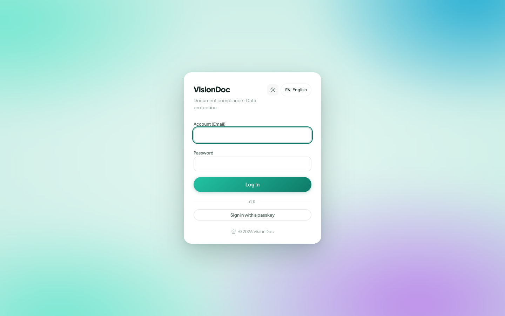

Production

# How to use VisionDoc

VisionDoc is your company’s document workspace. Sign in, see what needs attention, and keep the files in Drive.

Open it at **[https://app.visiondoc.ai](https://app.visiondoc.ai)**.

<figure class="shot">
  
  <figcaption>The production sign-in page.</figcaption>
</figure>

## Where things live

The sidebar has three groups.

| Group | Items |
|---|---|
| Overview | Dashboard, Drive, Search |
| Workflow | Start workflow, Inbox & outbox, Application folder, Purchase Requisition |
| Workspace | Signing, Rules, Audit, People & access, Security, Settings |

The sun icon at the bottom switches light and dark. **EN** switches the language. The door icon signs you out. **Ask** sits at the bottom right of every page.

These pictures were taken on production in November 2026.
