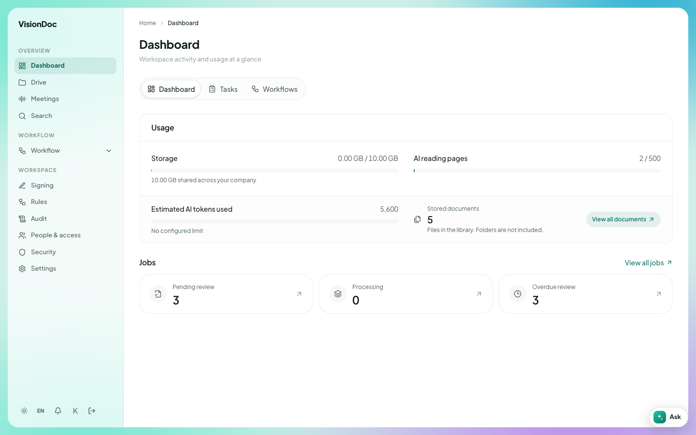

Home

# Dashboard

The first page after sign-in is the dashboard. It is **Workspace activity and usage at a glance**.

<figure class="shot">
  
  <figcaption>Dashboard on production. The numbers are for that company.</figcaption>
</figure>

Three tabs sit under the title: **Dashboard**, **Tasks**, and **Workflows**.

**Usage** shows:

- **Storage**, and how much of the company allowance is used
- **AI reading pages**
- **Estimated AI tokens used**
- **Stored documents**, with **View all documents**

**Jobs** shows **Pending review**, **Processing**, and **Overdue review**. **View all jobs** opens the full list.

Open **Dashboard** in the sidebar any time to come back here.
