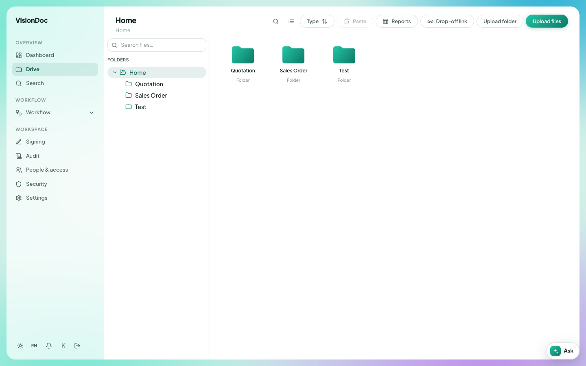

Files

# Drive

**Drive** is the library. The page you land in is **Home**.

<figure class="shot">
  
  <figcaption>Drive, open on Home. The folders shown belong to that company.</figcaption>
</figure>

A company starts with **Quotation**, **Sales Order**, and **Invoice** inside Home. You can rename Home and those three. You can add a folder inside Quotation, Sales Order, or Invoice. You cannot delete or move those four, and you cannot add a new folder beside them.

## Put files in

- **Upload files** sends the files you pick into the open folder.
- **Upload folder** sends a whole folder.
- Drop files on the open folder. The page says they will upload there.
- **Paste** puts a copied item into the folder you are in.
- **Drop-off link** lets a guest upload without a VisionDoc login.

**Search files…** filters the folder you are looking at. **Search** in the sidebar searches the workspace. **Type** changes the sort. **Reports** opens the reports for this library.

A filing rule can place a file in a different folder from the one you had open. The page tells you where it landed.

## A link for a guest

**Drop-off link** creates a link into the folder you choose. Guests do not need a console account.

You can require an email one-time code, and you can set how many hours the link lasts. **Create link**, then **Copy URL**. **Revoke** turns that link off. Files already uploaded stay in Drive.
