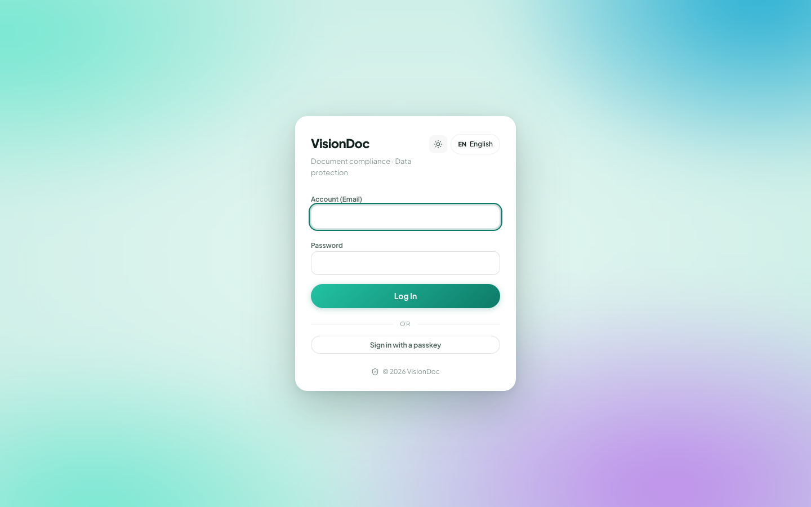
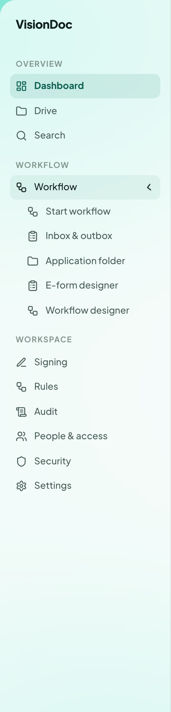

<a href="../zh/index.html">繁體中文</a>

# How to use VisionDoc

<figure class="watch">
  <video controls preload="none" playsinline poster="https://visiondoc-tutorials.s3.ap-southeast-1.amazonaws.com/posters/01-how-to-use-visiondoc.jpg" src="https://visiondoc-tutorials.s3.ap-southeast-1.amazonaws.com/videos/01-how-to-use-visiondoc.mp4"></video>
  <figcaption>Watch the video</figcaption>
</figure>

VisionDoc is your company’s document workspace. Sign in, see what needs attention, and keep the files in Drive.

  <a class="card card-sign" href="sign-in.html">
    <strong>Sign in</strong>
    Open the console with the account your company gave you.
  </a>
  <a class="card card-drive" href="drive.html">
    <strong>Drive</strong>
    Home holds Invoice, Quotation, and Sales Order.
  </a>
  <a class="card card-flow" href="start-workflow.html">
    <strong>Workflow</strong>
    Start a run, check the inbox, or design a form and a workflow.
  </a>
  <a class="card card-import" href="folder-import.html">
    <strong>Folder import</strong>
    Bring files in from a folder on your network.
  </a>

Open it at **[https://app.visiondoc.ai](https://app.visiondoc.ai)**. This book has an English copy and a Traditional Chinese copy. In the console, **EN** at the bottom left switches the language the same way.

<figure class="shot">
  
  <figcaption>The production sign-in page, in English.</figcaption>
</figure>

## Where things live

The sidebar has three groups.

| Group | Items |
|---|---|
| Overview | Dashboard, Drive, Search |
| Workflow | A menu: Start workflow, Inbox & outbox, Application folder, E-form designer, Workflow designer |
| Workspace | Signing, Rules, Audit, People & access, Security, Settings |

**Workflow** is the row with a chevron. Click the row and the chevron turns up. The menu under it is the whole Workflow group. Each item has its own page in this book.

<figure class="shot">
  
  <figcaption>The console menu. Workflow is open.</figcaption>
</figure>

Company administrators see the setup items: E-form designer, Workflow designer, Rules, People & access, and Settings. Another role sees the items that role allows.

The sun icon switches light and dark. **EN** switches the language. The door icon signs you out. **Ask** sits at the bottom right of every page.

These pictures were taken on production in November 2026.
