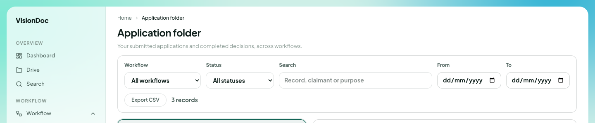

Work

# Application folder

<a href="../videos/16-application-folder.mp4">Watch the video</a>

**Application folder** is the list of applications and the decision on each one. The line under the title says **Your submitted applications and completed decisions, across workflows.**

<figure class="shot">
  
  <figcaption>Filters across the top. The record rows are left out of this picture.</figcaption>
</figure>

| Control | What it does |
|---|---|
| Workflow | **All workflows**, or one workflow |
| Status | **All statuses**, or one status |
| Search | **Record, claimant or purpose** |
| From / To | A date range |
| Export CSV | Downloads the rows that match |

The picture says **3 records**. The rows themselves are not in the book.

Example: a quotation was submitted last week and you only want the ones still open. Set **Status** off **All statuses**, type a word from the purpose, and set **From** and **To** to that week. **Export CSV** saves those rows. **3 records** in the picture is this company's count, not a limit.
