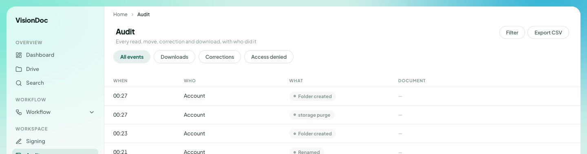

Workspace

# Audit

<a href="https://visiondoc-tutorials.s3.ap-southeast-1.amazonaws.com/videos/21-audit.mp4">Watch the video</a>

**Audit** reads **Every read, move, correction and download, with who did it**.

<figure class="shot">
  
  <figcaption>Four events. The document column is empty in these rows. Later rows are left out.</figcaption>
</figure>

Four filters sit under the title: **All events**, **Downloads**, **Corrections**, and **Access denied**. **Filter** narrows the list further. **Export CSV** downloads it.

The columns are **When**, **Who**, **What**, and **Document**. In the picture, **Who** is **Account** on each row. **What** is **Folder created**, **storage purge**, **Folder created** again, and **Renamed**. The times are 00:27, 00:27, 00:23, and 00:21. **Document** is a dash on these rows.

Example: someone says a folder appeared overnight. Open **Audit**, leave **All events** selected, and read the **Folder created** rows. To see only files that left the workspace, select **Downloads**. **Export CSV** keeps a copy of that view. The picture stops before any file name.
