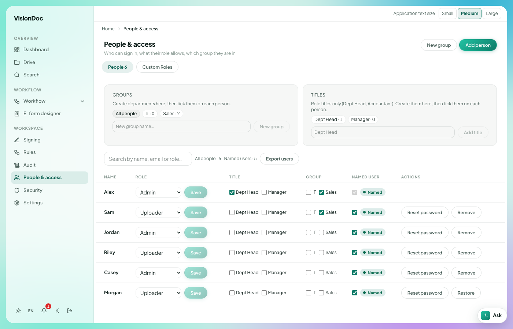

Workspace

# Change the admin

**Change the admin** gives a person the **Admin** role, or takes that role away. You do this on **People & access**. The password stays as it is.

Sign in at [app.visiondoc.ai](https://app.visiondoc.ai) as an **Admin**. Open **People & access**.

Find the person. In **Role**, open the menu. **Built-in roles** are **Admin**, **Compliance**, and **Uploader**. **Custom roles**, when this company has any, are listed under those.

Choose **Admin**. Click **Save** on that same row. **Save** stays off until the role is different from the one already saved.

VisionDoc signs that person out. They sign in again, and the new role is then in effect. The message says **Role saved. The user must sign in again for their new access.**

<figure class="shot">
  
  <figcaption>Role and Save are on each row. The names in this picture are examples.</figcaption>
</figure>

## Hand the company to a new admin

Make the new person an **Admin**, and click **Save**, before you change your own role.

When you save a new role on your own row, VisionDoc returns you to the sign-in page.

## What to watch for

Only an **Admin** can change a role. A person who can open Settings, and who is not an **Admin**, cannot save one.

**Save** changes that one person.

Leave another **Admin** in place before you change your own role. The page does not keep a spare **Admin** for you. After the last **Admin** becomes **Uploader**, nobody left can change roles.

The password stays as it is. **Reset password** is a separate button, and it is absent on your own row. The new password is shown once. Give it to that person directly. They choose their own password before they can use the console.

**Named** is separate from **Admin**. Only a **Named** user can sign in. A **Non-Named** account does not use a **Named** seat. You cannot turn **Named** off on yourself.

**Starter** allows 2 **Named** users. **Advance** allows 5. Accounts already over that number stay. Changing a role does not use a new seat. Adding another **Named** user, once the package is full, is refused. The message says **This package allows 2 Named users. Create a Non-Named account or free a Named seat first.** On Advance, that number is 5. A company with no **Named**-user cap does not get that refusal.

A custom role is a different choice from the built-in **Admin**. Pick one. The custom role still has a base of **Admin**, **Compliance**, or **Uploader**.

**Remove** is a different button. It stops that person signing in, and the audit history stays. Use **Role** and **Save** when you only want to change who is an **Admin**.

If the person is not in the list yet, click **Add person**. Under **Create user**, set the role to **Admin**. Set **User type** to **Named** when they must sign in. The password is at least 12 characters. Give it to them directly.
