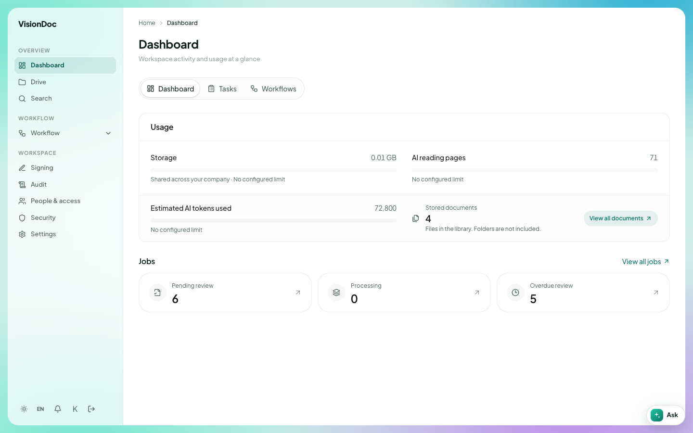

Home

# Dashboard

<a href="../videos/03-dashboard.mp4">Watch the video</a>

The first page after sign-in is the dashboard. The line under the title says **Workspace activity and usage at a glance**.

<figure class="shot">
  
  <figcaption>This company's numbers. Storage is almost empty. Three files are waiting.</figcaption>
</figure>

## The three tabs

Three tabs sit under the title. **Dashboard** is the one selected.

| Tab | Where it goes |
|---|---|
| Dashboard | This page. The usage and the job counts |
| Tasks | The same list as Inbox & outbox. Work assigned to you |
| Workflows | The list of workflows you can start. The same page as Start workflow |

## Usage

**Usage** is the card under the tabs. Company administrators see it. Another person sees the line **Workspace administrators can view usage and subscription details.**

The card has four figures.

### Storage

**Storage** reads **0.00 GB / 10.00 GB**. The first number is how much of the library is in use. The second number is the allowance. The bar under the numbers shows that fill. Here the bar is empty, because 0.00 GB of 10.00 GB is in use.

The line under the bar says **10.00 GB shared across your company**. That allowance belongs to the whole company. It is not a separate 10 GB for each person.

### AI reading pages

**AI reading pages** reads **2 / 500**. One reading page is one page VisionDoc has read off a file. This company may read 500 pages. Two have been read. The thin mark in the bar is those 2 pages out of 500.

### Estimated AI tokens used

**Estimated AI tokens used** reads **5,600**. A token is a small piece of the text the AI reads. The number is an estimate of how much of that reading the company has used.

The line under it says **No configured limit**. This company has no cap on tokens, so there is no total for the 5,600 to be "out of". The bar stays grey.

### Stored documents

**Stored documents** reads **5**. The line under it says **Files in the library. Folders are not included.** A folder such as Invoice does not add to this count. A PDF inside it does.

**View all documents** opens Drive.

## Jobs

**Jobs** is the heading under the usage card. A job is one file the company has sent in for reading.

**View all jobs**, at the right of the heading, opens the full list. That page is titled **Jobs**. The line under the title says **Document processing job list · click a row for a quick preview.**

Three cards sit under the heading. Each card opens Inbox & outbox. The arrow on the card is that link.

| Card | In the picture | What the number counts |
|---|---|---|
| Pending | 3 | Files a person still has to look at. VisionDoc has finished reading them |
| Processing | 0 | Files VisionDoc is still reading. Reading finishes as the file comes in, so this count stays at 0 |
| Submitted | 3 | Files that have been sitting in Pending for more than a day |

In this picture **Pending** and **Submitted** are both 3. Every file that is waiting has been waiting for more than a day.

Example: the company has 10.00 GB and is using none of it yet. Two pages have been read, and that reading is estimated at 5,600 tokens, with no token cap set. Five files are in the library. Three of them are waiting for a person, and all three have waited more than a day. Click **Pending** or **Submitted** to open them in Inbox & outbox. Click **View all documents** to see the five files in Drive.
