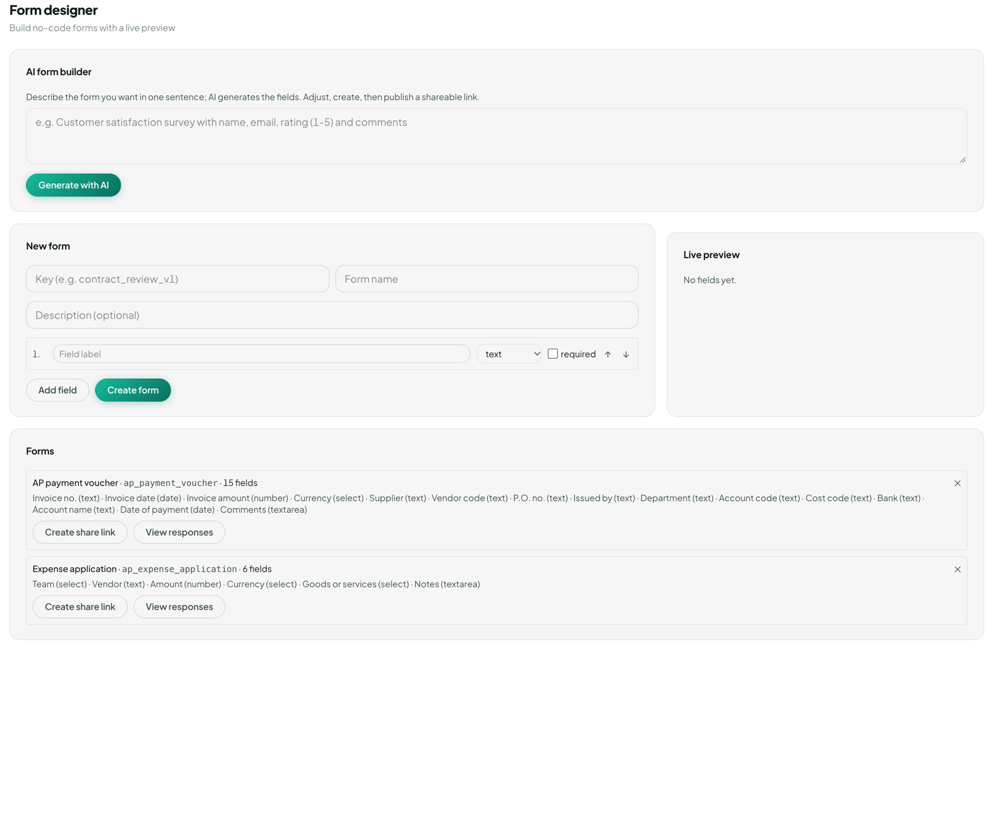

Work

# E-form designer

<a href="https://visiondoc-tutorials.s3.ap-southeast-1.amazonaws.com/videos/17-eform-designer.mp4">Watch the video</a>

**E-form designer** builds a form without code, then shares it. The page title is **Form designer**. The line under it says **Build no-code forms with a live preview**.

<figure class="shot">
  
  <figcaption>The builder is empty. Two forms are already saved: AP payment voucher and Expense application.</figcaption>
</figure>

The page is three cards. **AI form builder** and **New form** make a form. **Forms** is the list of forms already saved.

## AI form builder

The hint says **Describe the form you want in one sentence; AI generates the fields. Adjust, create, then publish a shareable link.**

The box already shows an example: **e.g. Customer satisfaction survey with name, email, rating (1–5) and comments**. Replace that sentence with your own. **Generate with AI** reads the sentence and fills **New form**: a key, a name, and one row per question. You still check the rows, then click **Create form**. Nothing is saved by **Generate with AI** alone.

## New form

Fill this card by hand, or let the AI fill it and then edit it.

| Control | What it is |
|---|---|
| Key | The id of the form, such as `contract_review_v1`. The saved forms below use `ap_payment_voucher` and `ap_expense_application`. The key is how the form is named in the list |
| Form name | The name people see, such as AP payment voucher |
| Description | Optional. Leave it blank if the name is enough |
| 1. | The first question. **Add field** adds 2, then 3 |
| Field label | The question, such as Invoice no. |
| Type | What kind of answer. The choices are below |
| required | Tick it when the answer cannot be left blank |
| ↑ ↓ | Move this question up or down |
| ✕ on a row | Remove that question. The first row stays while it is the only one |
| Add field | Another question |
| Create form | Save. The form needs a key, a name, and at least one question that has a label |

The type menu:

| Type | The answer |
|---|---|
| text | One line, such as a supplier name |
| textarea | Several lines, such as comments |
| number | A number, such as an amount |
| date | A date |
| select | One choice from a list. The row then asks for **Options (comma separated)**, for example `HKD, USD, EUR` |
| checkbox | Yes or no |
| image | A picture |

**Live preview** draws the form as you type. With no label filled in, it says **No fields yet.** Type Invoice no. in **Field label** and the preview shows that question. Change the type and the preview changes with it.

A saved form is not edited from the list. A change of questions is a new form, with its own key.

## Forms

**Forms** lists what is already saved. An empty company says **No forms yet.** This company has two.

Each row is **name · key · how many fields**, then the questions with their types, then three controls.

| Control | What it does |
|---|---|
| ✕ | **Delete form**. Confirm once. If people have already answered, a second confirm tells you those answers will be wiped |
| Create share link | Makes a link. The card then shows **Email invite**: the link, a copy button, **Recipient emails**, **Subject**, the invite message, **Draft with AI**, and **Send invite**. The person who opens the link fills the form and does not need a VisionDoc account |
| View responses | Opens **Responses** under that form. Each line is who answered, when, and the answers. None yet says **No responses yet.** **Download CSV / Excel** saves the answers |

### AP payment voucher

**AP payment voucher · ap_payment_voucher · 15 fields.** This is the form for paying a supplier invoice.

| Question | Type | What goes in it |
|---|---|---|
| Invoice no. | text | The invoice number |
| Invoice date | date | The date on the invoice |
| Invoice amount | number | How much the invoice is for |
| Currency | select | Which currency |
| Supplier | text | The supplier's name |
| Vendor code | text | The supplier's code in the company's books |
| P.O. no. | text | The purchase-order number |
| Issued by | text | Who issued the voucher |
| Department | text | Which department |
| Account code | text | The account to charge |
| Cost code | text | The cost code |
| Bank | text | The bank |
| Account name | text | The account name |
| Date of payment | date | When it is paid |
| Comments | textarea | Any note |

### Expense application

**Expense application · ap_expense_application · 6 fields.** This is the form for an expense claim.

| Question | Type | What goes in it |
|---|---|---|
| Team | select | Which team |
| Vendor | text | Who is being paid |
| Amount | number | How much |
| Currency | select | Which currency |
| Goods or services | select | What was bought |
| Notes | textarea | Any note |

Example: a customer survey is not in the list yet. Type **Customer satisfaction survey with name, email, rating (1–5) and comments**, click **Generate with AI**, and read the rows in **Live preview**. Tick **required** on the email question. Click **Create form**. The new form appears under **Forms**, next to the voucher and the expense application. **Create share link** is the link you send. Answers come back under **View responses**.
