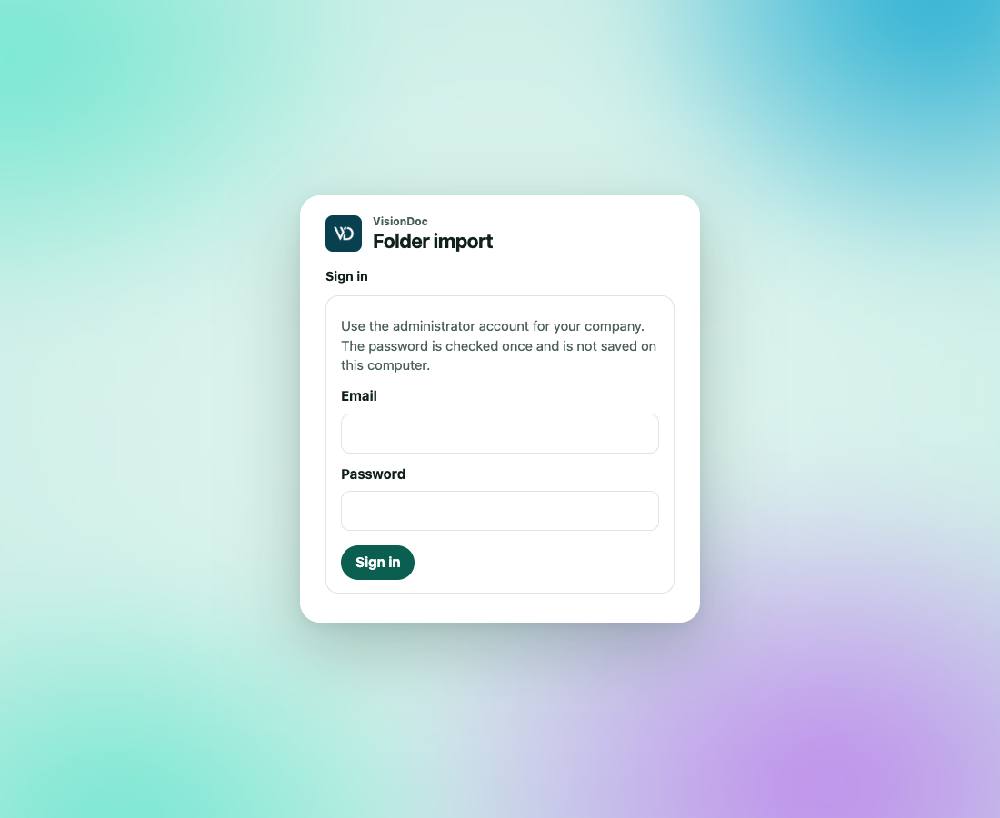

<p class="kicker">This computer</p>

# Folder import

<figure class="watch">
  <video controls preload="none" playsinline poster="https://visiondoc-tutorials.s3.ap-southeast-1.amazonaws.com/posters/26-folder-import.jpg" src="https://visiondoc-tutorials.s3.ap-southeast-1.amazonaws.com/videos/26-folder-import.mp4"></video>
  <figcaption>Watch the video</figcaption>
</figure>

Folder import runs on a computer that can see the network folder. It signs in to [https://app.visiondoc.ai](https://app.visiondoc.ai), reads the folder, and uploads new files. It does not change or delete the files in that folder.

This page is for the person who sets up that computer. The commands below are typed on that computer, not inside VisionDoc.

<figure class="shot">
  
  <figcaption>The setup page. It stays in English, and it stays light.</figcaption>
</figure>

The program is the public image [ghcr.io/kaff-international-limited/visiondoc-smb](https://github.com/kaff-international-limited/visiondoc-smb/pkgs/container/visiondoc-smb). You do not need a GitHub login to download it.

## What you need

- Docker on that computer.
- An admin account on VisionDoc.
- Your company must already be allowed to connect an importer. If sign-in says the company is not enabled, ask the person who runs VisionDoc for your company.
- An account that can read the folder is enough. It does not need to change the folder.

## Start it

On the computer that should do the importing:

```sh
docker pull ghcr.io/kaff-international-limited/visiondoc-smb:latest

docker run -d --name visiondoc-smb \
  --restart unless-stopped \
  -p 127.0.0.1:8787:8080 \
  -v visiondoc-smb:/data \
  --read-only \
  --tmpfs /tmp:size=64m,mode=1777 \
  --cap-drop ALL \
  --security-opt no-new-privileges:true \
  --memory 512m \
  ghcr.io/kaff-international-limited/visiondoc-smb:latest
```

Then open **http://localhost:8787** on that same computer. If that address is already in use, change the first number, for example `-p 127.0.0.1:8788:8080`.

The setup page stays light. It does not follow the light or dark choice you make in VisionDoc. The labels stay in English.

## Connect the company

1. Type the admin email and password.
2. Click **Sign in**.

The card says **Use the administrator account for your company. The password is checked once and is not saved on this computer.**

The password is checked once and is not saved on the computer. The next time someone opens **http://localhost:8787** on it, the company is already connected, for up to 30 days, or until someone signs out.

## Choose the folder

1. Pick **SMB**, **SFTP**, **FTPS**, or **WebDAV**.
2. Type the folder.
   - SMB uses a path such as `\\server\share\folder`.
   - SFTP uses `sftp://files.example/inbox`.
   - FTPS uses `ftps://files.example/inbox`.
   - WebDAV uses an `https://` address.
3. Type the username and password for that folder. For SMB you can use `DOMAIN\username`.
4. Click **Test connection and save**.
5. Click **Start import**.

Plain FTP and plain HTTP are refused. The page tells you the address shape for the choice you picked.

Files larger than 64 MB stay in the folder and are not uploaded. Every folder inside the folder is included.

The scanner drops PDFs into `\\files\scan\inbox`. Choose **SMB**, type `\\files\scan\inbox`, use a read-only account, then **Test connection and save** and **Start import**. A 2 MB invoice is uploaded. A 90 MB scan stays in the folder.

## What the status means

The three steps at the top are **Company**, **Folder**, and **Import**.

| Mark | What it means |
|---|---|
| Importing | A scan is running |
| Paused | The scan is stopped |
| Ready | The folder is saved and has not been scanned yet |
| Imported | That file is now in VisionDoc |
| Unchanged | The same file was already imported |
| Skipped | A copy of something already imported |
| Waiting | The file was still changing, so this scan left it |
| Failed | That file was not uploaded. The reason is on the row |

The same content is uploaded once, even if the file is renamed. A changed file becomes a new document. Deleting a file from the folder does not delete it in VisionDoc.

Refresh the page to update the list. **Scan again** runs another pass. **Pause** stops the scan.

`invoice-104.pdf` imports. Someone renames it to `invoice-104-signed.pdf` without changing the pages. The next scan marks it **Unchanged**. If they add a signature page, the next scan brings in the new file. Deleting the PDF from the share leaves the VisionDoc file where it is.

## Sign out and restart

**Sign out** only hides this setup screen. Import keeps running. The note under the button says **Hides this screen only. Import keeps running.**

Restarting the computer keeps the saved folder and the list of what was already imported. Do not remove the `visiondoc-smb` volume unless you mean to set it up again from the start.

This page is only on this computer. Do not open port 8787 to the internet.
