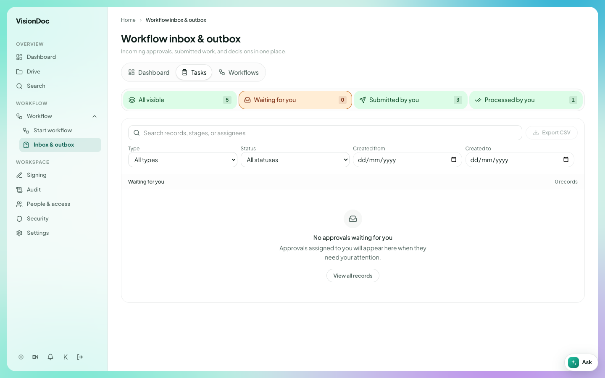

Work

# Inbox & outbox

<figure class="watch">
  <video controls preload="none" playsinline poster="https://visiondoc-tutorials.s3.ap-southeast-1.amazonaws.com/posters/15-inbox-and-outbox.jpg" src="https://visiondoc-tutorials.s3.ap-southeast-1.amazonaws.com/videos/15-inbox-and-outbox.mp4"></video>
  <figcaption>Watch the video</figcaption>
</figure>

**Inbox & outbox** is the list of work that is already moving. The title is **Workflow inbox & outbox**. The line under it says **Incoming approvals, submitted work, and decisions in one place.**

<figure class="shot">
  
  <figcaption>Waiting for you is selected. Nothing needs approval.</figcaption>
</figure>

Four numbers sit across the top. In the picture they are:

| Count | In the picture |
|---|---|
| All visible | 5 |
| Waiting for you | 0 |
| Submitted by you | 3 |
| Processed by you | 1 |

**Waiting for you** is selected. The list says **No approvals waiting for you.** The line under that says **Approvals assigned to you will appear here when they need your attention.** **View all records** clears that filter.

**Tasks** on the dashboard opens this same list.

The search box says **Search records, stages, or assignees**. **Type** starts at **All types**. **Status** starts at **All statuses**. **Created from** and **Created to** are dates. **Export CSV** downloads the list you are looking at.

A manager opens **Inbox & outbox**, leaves **Waiting for you** selected, and approves the quotation. **Waiting for you** goes back to 0. **Processed by you** goes up by one. The salesperson opens the same page, clicks **Submitted by you**, and sees the three they already sent.
