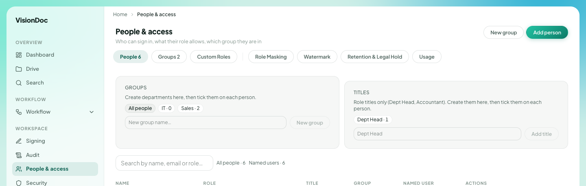

Workspace

# People & access

<a href="https://visiondoc-tutorials.s3.ap-southeast-1.amazonaws.com/videos/22-people-and-access.mp4">Watch the video</a>

**People & access** says **Who can sign in, what their role allows, which group they are in**.

<figure class="shot">
  
  <figcaption>Groups and titles. The person rows are left out of this picture.</figcaption>
</figure>

**New group** and **Add person** are at the top right.

| Tab | In the picture |
|---|---|
| People | 6 |
| Groups | 2 |
| Custom Roles | Roles you add |
| Role Masking | What each role sees |
| Watermark | A mark on the way out |
| Retention & Legal Hold | How long files stay |
| Usage | Storage and reading for this company |

**Groups** says **Create departments here, then tick them on each person.** The chips are **All people**, **IT · 0**, and **Sales · 2**. The box reads **New group name…**.

**Titles** says **Role titles only (Dept Head, Accountant). Create them here, then tick them on each person.** The picture has **Dept Head · 1**.

The table columns are **Name**, **Role**, **Title**, **Group**, **Named user**, and **Actions**. The search box reads **Search by name, email or role…**. The line beside it says **All people · 6** and **Named users · 6**.

Example: two people work in sales. **Sales · 2** is that group. Type a new department in **New group name…** and click **New group**, then tick it on each person. **Dept Head · 1** means one person already has that title. Add another title in the **Titles** box, click **Add title**, and tick it on the person who should have it. The names are not in this picture.
