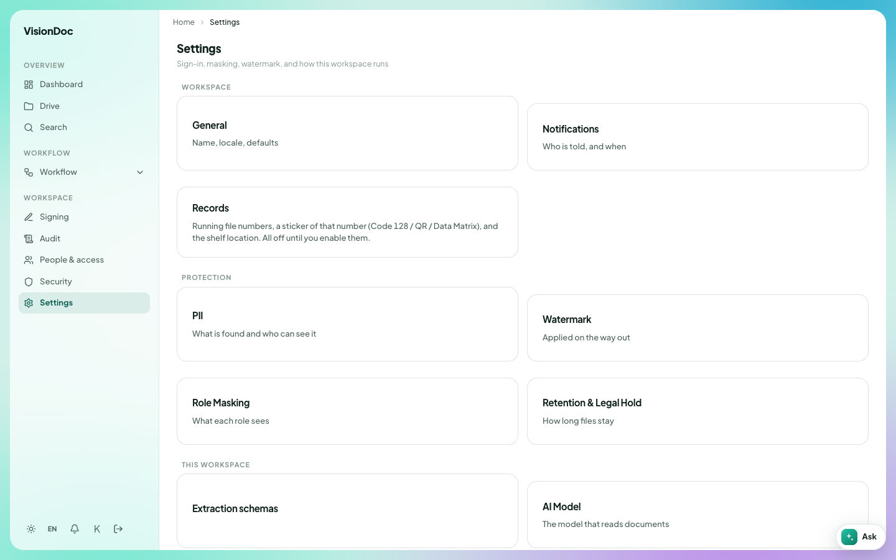

Records

# Retention

<figure class="watch">
  <video controls preload="none" playsinline poster="https://visiondoc-tutorials.s3.ap-southeast-1.amazonaws.com/posters/25-retention.jpg" src="https://visiondoc-tutorials.s3.ap-southeast-1.amazonaws.com/videos/25-retention.mp4"></video>
  <figcaption>Watch the video</figcaption>
</figure>

<figure class="shot">
  
  <figcaption>Retention & Legal Hold is on Settings.</figcaption>
</figure>

Retention is how long a file stays. You set it on one file or one folder in Drive. People who manage the company also set the rules for the whole company in Settings.

## Keep period

Right-click a file or a folder in Drive. People who manage the company see **Keep period**. The box is titled **Keep period**, then the name.

The box shows where the current period comes from, and when the file expires.

| Line | What it says |
|---|---|
| Source | **this file**, **folder**, **classification**, **tenant (all)**, **AI suggestion (not accepted)**, or **none** |
| Expires | A date, or **none**. A file on a legal hold also says **on hold** |

| Choice | What it does |
|---|---|
| Inherit (folder / tenant policy) | This file follows the folder, or the company rule. On a folder, this clears that folder's own default |
| Keep for N days | Keep it for the number of days you type. The box starts at 365 |
| Keep until date | Keep it until the date you pick |
| Keep permanently | Do not let the period end |

Click **Save keep period**. The page says **Keep period saved**.

A folder with no default of its own says **No folder default — child files use tenant policy.**

When a document is read, the AI can suggest a period. The box titles that **AI keep-period suggestion** and shows the number of days. **Accept suggestion** makes that the keep period for this file. A suggestion is not thrown away on its own. The hint on the settings page says a suggestion is never auto-disposed.

Quotations should stay for a year. Right-click **Quotation**, choose **Keep period**, choose **Keep for N days**, leave 365, and click **Save keep period**. A file inside **Quotation** follows that year unless you set a period on the file itself.

## Records retention and legal hold

Open **Settings**, then **Retention & Legal Hold**. The page title is **Records retention & legal hold**. The line under it says **Retention policies, disposal sweep, and legal holds**. The line on the card says **How long files stay**.

### AI keep-period prompt

**AI keep-period prompt** is the instruction the AI uses when it reads a document. **Save prompt** keeps it. Leave it empty and VisionDoc uses its built-in table. The hint names invoices at 7 years and KYC at 5 years. A suggestion from this prompt is never thrown away until someone clicks **Accept suggestion**.

### Retention policies

**Retention policies** is the list of company rules. **No policies yet** means the list is empty.

| Box | What it does |
|---|---|
| Policy name | The name of the rule |
| Retention days | How many days the rule keeps a file |
| dispose | When the period ends, the file can be thrown away |
| flag | When the period ends, the file is marked, and it stays |
| all documents | The rule applies to every document |
| by classification | The rule applies to one label, such as RESTRICTED |
| Add policy | Saves the rule |

### Legal holds

**Legal holds** stops disposal for the files you name. **No legal holds** means none are in place.

| Box | What it does |
|---|---|
| Matter name | The name of the hold |
| Reason (optional) | Why the hold exists |
| Job IDs (comma or newline separated) | The files the hold covers |
| Place hold | Turns the hold on. The hold is **active** |
| Release | Lifts the hold. It becomes **released** |

A file on a hold says **on hold** in its keep-period box. A disposal sweep leaves it alone.

### Retention preview

**Retention preview** counts the files: how many are live, how many are expired, how many are on hold, and how many can be thrown away. **Nothing to preview** means the count is empty.

**Run disposal sweep** throws away the files the preview marks, and deletes their stored files. The page asks first. The question says this permanently disposes of those records and deletes their stored files, and that it cannot be undone.

A tax invoice should stay 7 years, and one contract is in a dispute. Add a policy named `Tax invoices`, set 2555 days, choose **dispose**, and choose **by classification**. Place a hold named `Contract dispute` on that one file. The sweep can throw away invoices that have passed 2555 days. The contract stays, because it is on hold.
