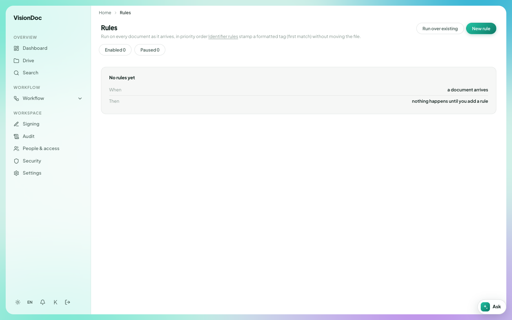

Workspace

# Rules

<figure class="watch">
  <video controls preload="none" playsinline poster="https://visiondoc-tutorials.s3.ap-southeast-1.amazonaws.com/posters/20-rules.jpg" src="https://visiondoc-tutorials.s3.ap-southeast-1.amazonaws.com/videos/20-rules.mp4"></video>
  <figcaption>Watch the video</figcaption>
</figure>

**Rules** sits under Workspace, between Signing and Audit. A rule runs on every file as it arrives, in order. The line under the title says a matching rule stamps a tag on the file. It does not move the file.

<figure class="shot">
  
  <figcaption>No rules yet. Enabled 0. Paused 0.</figcaption>
</figure>

The empty card says **No rules yet**. Under that it says **When a document arrives** and **Then nothing happens until you add a rule**. **Enabled** is 0. **Paused** is 0.

**New rule** adds one. **Run over existing** applies the rules to files already in Drive.

You want new invoices tagged `INV-2026` as soon as they arrive, without anyone moving the file. Click **New rule** and add that. Until you do, a new file arrives and nothing happens. After the rule is on, **Enabled** becomes 1. **Run over existing** tags the invoices already in the library. Pause a rule when you want it to stop without deleting it. **Paused** then goes up by one.
