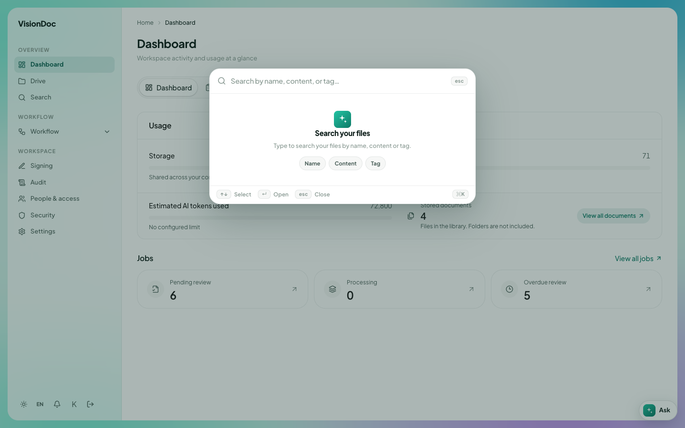

Find a file

# Search

<a href="../videos/13-search.mp4">Watch the video</a>

**Search** in the sidebar opens a window over the page. It searches the workspace, not just the folder you have open.

<figure class="shot">
  
  <figcaption>Search your files. Choose name, content, or tag.</figcaption>
</figure>

Type in **Search by name, content, or tag…**. Three chips narrow it:

| Chip | Example |
|---|---|
| Name | `invoice` finds a file whose name contains invoice |
| Content | The word inside the PDF, even when the file name does not say it |
| Tag | A tag someone put on the document |

The arrows choose a result. **Open** opens it. **esc** closes the window.

**Search files…** inside Drive is different. That box only filters the folder on the screen.
