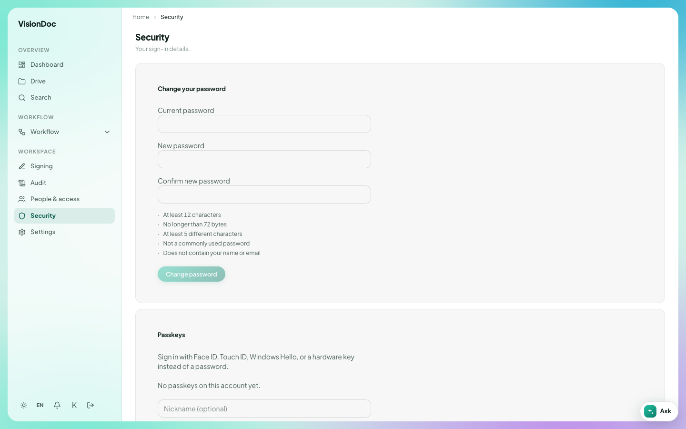

Workspace

# Security

**Security** is **Your sign-in details.** It is your own account, not the company list.

<figure class="shot">
  
  <figcaption>Change your password. This account has no passkey yet.</figcaption>
</figure>

**Change your password** asks for **Current password**, **New password**, and **Confirm new password**. The new password has to be:

- At least 12 characters
- No longer than 72 bytes
- At least 5 different characters
- Not a commonly used password
- Not containing your name or email

**Change password** saves it.

**Passkeys** lets you sign in with Face ID, Touch ID, Windows Hello, or a hardware key instead of a password. The picture says **No passkeys on this account yet.** **Nickname (optional)** is the name you give that key.

Example: replace a short password with one of 12 characters that does not contain your name. Type it twice, then click **Change password**. To stop typing it, add a passkey on this same page and give it a nickname such as "Office laptop". The sign-in page then offers **Sign in with a passkey**.
