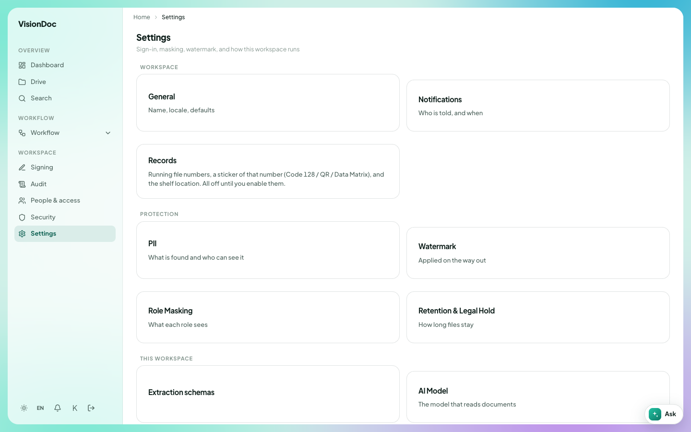

Workspace

# Settings

<figure class="watch">
  <video controls preload="none" playsinline poster="https://visiondoc-tutorials.s3.ap-southeast-1.amazonaws.com/posters/24-settings.jpg?v=20261116" src="https://visiondoc-tutorials.s3.ap-southeast-1.amazonaws.com/videos/24-settings.mp4?v=20261116"></video>
  <figcaption>Watch the video</figcaption>
</figure>

**Settings** is how the company is set up. The line under the title says **Sign-in, masking, watermark, and how this workspace runs**.

<figure class="shot">
  
  <figcaption>The company settings. Records stay off until someone turns them on.</figcaption>
</figure>

| Card | What it is |
|---|---|
| General | The company name, the language, and the defaults |
| Notifications | Who is told, and when |
| Records | A running number on each file, a sticker of that number (Code 128, QR, or Data Matrix), and the shelf location. All off until you turn them on |
| PII | Personal details that are found, and who can see them |
| Watermark | A mark added when a file is sent out |
| Role Masking | What each role is allowed to see |
| Retention & Legal Hold | How long files stay. The page is [Retention](retention.md) |
| Extraction schemas | How details are read off a document |
| AI Model | The model that reads documents |

The company wants Chinese as the default language. Open **General** and set the language there. To put a running number on each new file, open **Records** and turn that on. Until then the card stays off, which is what the picture shows. **Notifications** is where you choose who is told when a file needs a person to look at it.

## Change a setting

1. Open **Settings** and choose the relevant card or section.
2. Check that you are in the intended company. Settings apply to that company's workspace.
3. Change the values and use that section's **Save** button. Check the success or validation message before leaving.
4. Reload the section to confirm the saved value, then test the effect with a suitable account and synthetic document.

The account needs **Edit settings** (`settings:edit`) to make changes. Depending on the section, an account without it may see a read-only page or no entry at all. A feature may also be unavailable because the company module or required service is not enabled. See [Permissions](permissions.md) for how to distinguish these cases.

## Choose the right control

| What you want to do | Use | What to verify |
|---|---|---|
| Change what a person can do | **People & access**, Custom Roles and individual permissions | The person's **Info → Effective permissions** |
| Restrict one folder or document | Its **Permissions** editor in Drive | The effective result for an intended recipient and an excluded person |
| Hide common sensitive categories from non-admin roles | **PII** | Save, then test as Uploader and Compliance |
| Hide a particular field or pattern from selected roles | **Role Masking** | Correct field key/type, denied roles and an actual output |
| Mark a document when it leaves the system | **Watermark** | The generated output; a watermark does not remove sensitive values |
| Change which fields are extracted | **Extraction schemas** | A test document's extracted fields and export headings |
| Number and locate physical files | **Records** | Enable only the required numbering, label and location features |
| Set file retention or a hold | **Retention & Legal Hold** | The file/folder policy and any hold; do not use the PII card's retention field as a deletion schedule |
| Change your own password or passkeys | **Security** | Your personal sign-in settings, separate from company configuration |

For the full masking procedure and current limitations, read [PII and role masking](pii.md). It explains how the PII checkboxes combine with role rules and why a protected download or online editing session can be refused.

## Check and undo a change

Record the previous value before changing a policy. To undo it, restore that value and save again; leaving the page does not undo a saved change. For file permissions, removing a rule restores inheritance/defaults, which may allow access.

Review relevant recorded events in **Audit** and use **Who** / **What** to locate them. Test with the affected user's account: an Admin account bypasses file ACLs and role masking, so it cannot demonstrate the restricted user's experience.

The screenshot and video provide an overview. Available cards and exact controls depend on the current release, company modules and your effective permissions.
