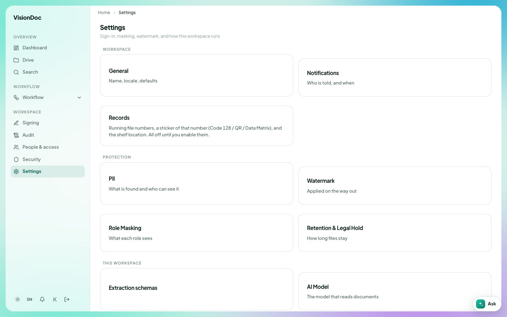

Workspace

# Settings

<a href="https://visiondoc-tutorials.s3.ap-southeast-1.amazonaws.com/videos/24-settings.mp4">Watch the video</a>

**Settings** reads **Sign-in, masking, watermark, and how this workspace runs**.

<figure class="shot">
  
  <figcaption>The company workspace. Records stay off until someone turns them on.</figcaption>
</figure>

| Card | What it is |
|---|---|
| General | Name, locale, defaults |
| Notifications | Who is told, and when |
| Records | Running file numbers, a sticker of that number (Code 128 / QR / Data Matrix), and the shelf location. All off until you enable them |
| PII | What is found and who can see it |
| Watermark | Applied on the way out |
| Role Masking | What each role sees |
| Retention & Legal Hold | How long files stay. The page is [Retention](retention.md) |
| Extraction schemas | How fields are read off a document |
| AI Model | The model that reads documents |

Example: the company wants Traditional Chinese as the default. Open **General** and set the locale there. To put a running number on each new file, open **Records** and turn that on. Until then the card stays off, which is what the picture says. **Notifications** is where you choose who hears about a file that needs review, and when.
