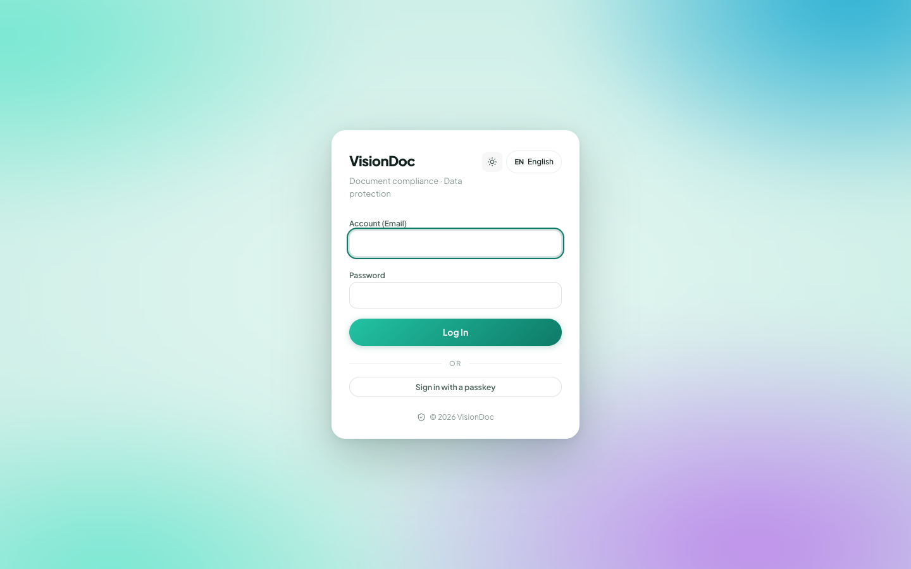

Account

# Sign in

<figure class="watch">
  <video controls preload="none" playsinline poster="https://visiondoc-tutorials.s3.ap-southeast-1.amazonaws.com/posters/02-sign-in.jpg" src="https://visiondoc-tutorials.s3.ap-southeast-1.amazonaws.com/videos/02-sign-in.mp4"></video>
  <figcaption>Watch the video</figcaption>
</figure>

<figure class="shot">
  
  <figcaption>Account, password, Log In, or a passkey.</figcaption>
</figure>

1. Open [https://app.visiondoc.ai](https://app.visiondoc.ai).
2. Enter **Account (Email)** and **Password**.
3. Click **Log In**.

The card says **Document compliance · Data protection**. Use the account your company gave you.

If the account or password is wrong, the page says **Incorrect account or password, please try again.**

**Sign in with a passkey** works when this browser already has one for that account. **EN English** on the card switches this page to Traditional Chinese.

**Log out** is the door icon at the bottom of the sidebar. That ends the session on this browser. It does not delete files.
