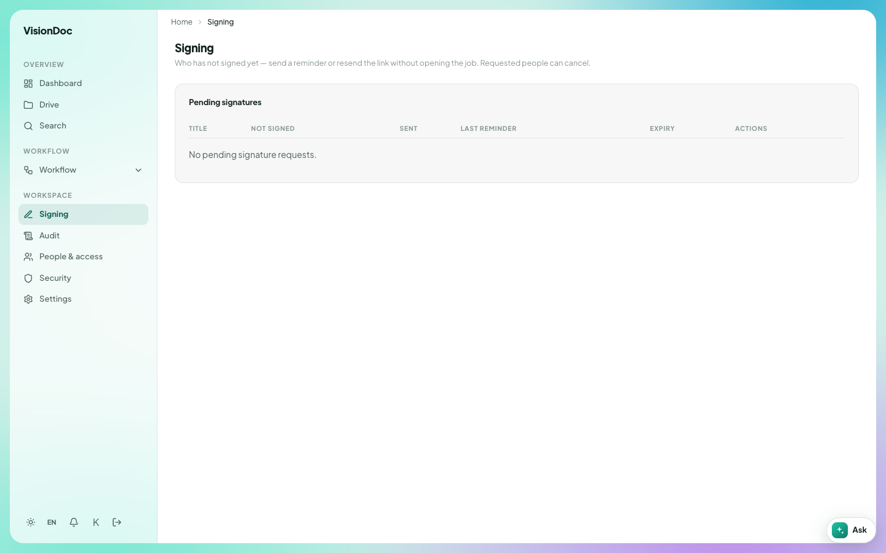

Signatures

# Signing

<a href="https://visiondoc-tutorials.s3.ap-southeast-1.amazonaws.com/videos/19-signing.mp4">Watch the video</a>

**Signing** is the first item under Workspace. It lists signature requests that are still open.

<figure class="shot">
  
  <figcaption>Pending signatures. This company has none waiting.</figcaption>
</figure>

The line under the title says **Who has not signed yet — send a reminder or resend the link without opening the job. Requested people can cancel.**

The table is **Pending signatures**.

| Column | What it shows |
|---|---|
| Title | The document |
| Not signed | Who still has to sign |
| Sent | When the request went out |
| Last reminder | The last time a reminder was sent |
| Expiry | When the request ends |
| Actions | Remind, resend, or cancel |

An empty list says **No pending signature requests.** You only see requests for your company.

Example: a customer was asked to sign the quotation on Monday, and by Wednesday the **Not signed** column still has their name. Open **Signing**, find that row, and send a reminder from **Actions** without opening the file. When they sign, the row leaves this list. If the date in **Expiry** has passed, send a new request instead of another reminder. The picture has no rows, so there is nothing to remind.

A drop-off link in Drive can also ask for a signature after a guest uploads. That option is **Then request e-sign**. The signed file then shows on this page until everyone named on it has signed.
