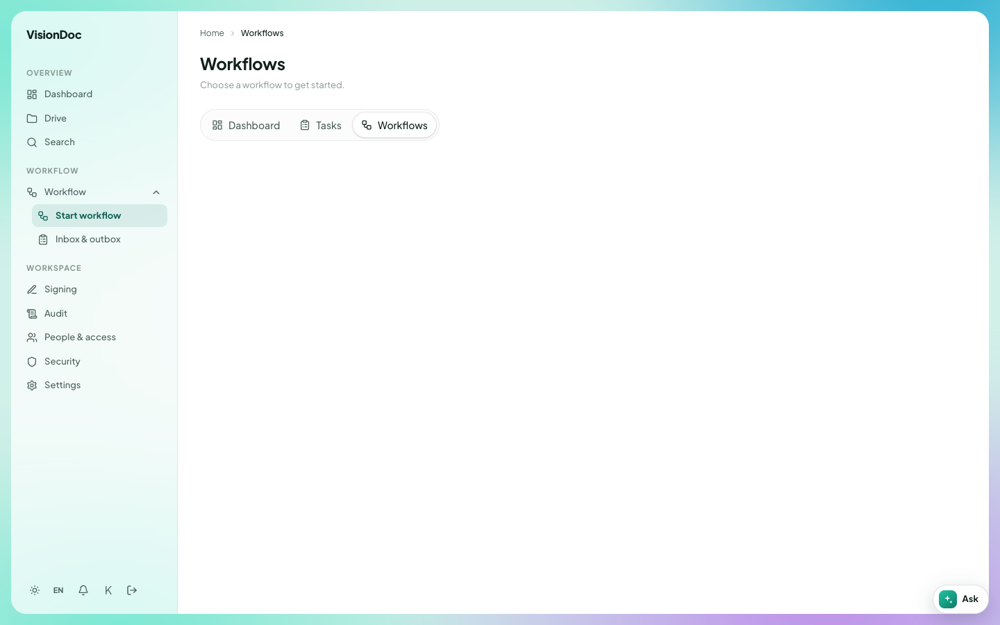

Work

# Start workflow

**Start workflow** is the first item in the Workflow menu. It opens **Workflows**. The line under the title says **Choose a workflow to get started.**

<figure class="shot">
  
  <figcaption>No workflow is set up on this company yet, so the list is empty.</figcaption>
</figure>

The same three tabs sit here as on the dashboard: **Dashboard**, **Tasks**, and **Workflows**. **Workflows** is the one selected.

Example: a salesperson has a quotation PDF in **Quotation** and needs a manager to approve it. They open **Start workflow**, pick the quotation workflow the company has set up, and attach that PDF. The run then shows up in **Inbox & outbox** for the manager. This company has no workflow in the list yet, so there is nothing to pick. A company administrator adds one in [Workflow designer](workflow-designer.md).
