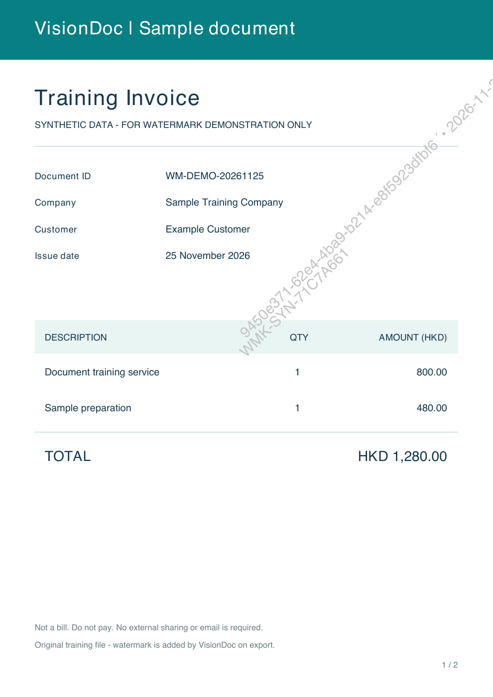
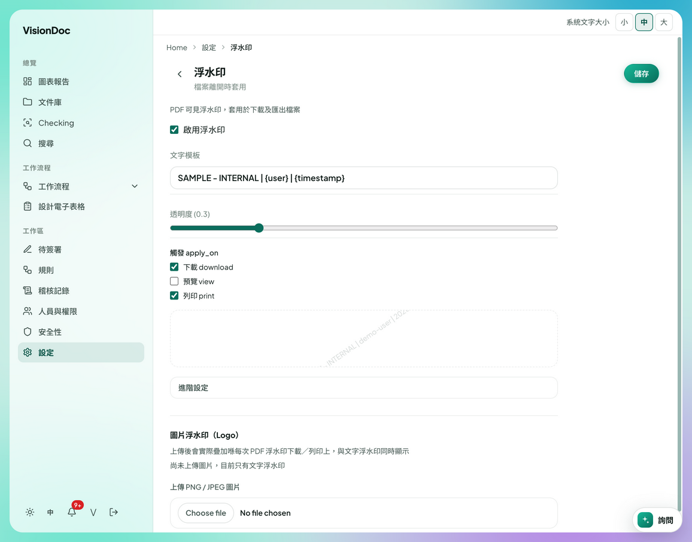
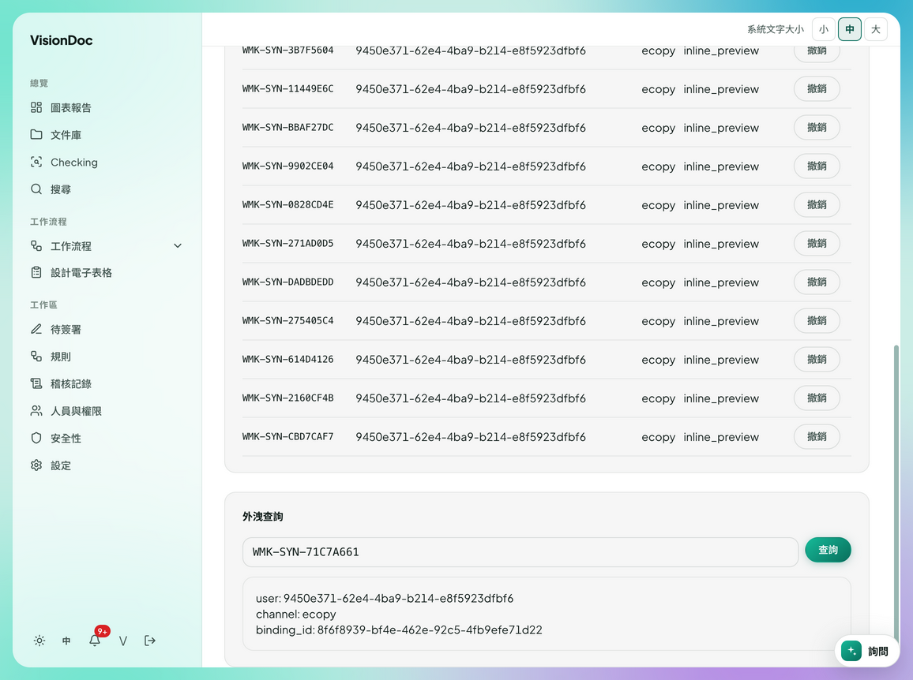

<p class="kicker">Workspace · Settings</p>

# Watermark tutorial and samples

See the settings, compare the exported PDFs, and look up an output token. This example uses a **synthetic two-page document**, tested on **VisionDoc Dev on 25 November 2026**. It is not a production verification.

> **The output route matters.** In this test, ordinary Download embedded a hidden tracing token only. The visible samples came from the secure-export API. The saved custom text did not appear in those exports, and long account/timestamp text was clipped. Saving settings is not proof that every download route applies them.

<figure class="watch">
  <video controls preload="none" playsinline poster="../assets/watermark/2026-11-25-v1/poster.png" src="../assets/watermark/2026-11-25-v1/tutorial.mp4">
    <track kind="captions" src="../assets/watermark/2026-11-25-v1/captions.zh-Hant.vtt" srclang="zh-Hant" label="Traditional Chinese">
  </video>
  <figcaption>2 min 43 sec. Cantonese synthetic narration and burned-in Traditional Chinese captions; real Dev screenshots with animated explanations. Local Sinji voice; pronunciation was not independently checked by listening.</figcaption>
</figure>

[Video](../assets/watermark/2026-11-25-v1/tutorial.mp4) · [Chinese captions](../assets/watermark/2026-11-25-v1/captions.zh-Hant.srt) · [Chinese PDF guide](../assets/watermark/2026-11-25-v1/guide.zh-Hant.pdf) · [Download the tutorial ZIP](../assets/watermark/2026-11-25-v1/tutorial-pack.zip)

## Compare four sample PDFs

Each PDF has two pages. Exported samples contain the exact bytes returned by the server, without a locally added watermark or visual cleanup.

| Sample | Observed result |
|---|---|
| [01 Original](../assets/watermark/2026-11-25-v1/01-original.pdf) | Synthetic Training Invoice, HKD 1,280.00; no added watermark. Not a bill; do not pay |
| [02 Ordinary download](../assets/watermark/2026-11-25-v1/02-hidden-token.pdf) | Original appearance, hidden token `WMK-SYN-33B38637` |
| [03 Secure print](../assets/watermark/2026-11-25-v1/03-print-footer.pdf) | Visible footer watermark, token `WMK-SYN-9039AEBE` |
| [04 Secure download](../assets/watermark/2026-11-25-v1/04-visible-watermark.pdf) | Visible diagonal watermark, token `WMK-SYN-71C7A661` |

<figure class="shot">
  
  <figcaption>Page one of the actual secure download. Open the PDF to inspect both pages at full size; the clipping is retained.</figcaption>
</figure>

## 1. Check permissions and the company

| Operation | Required capability |
|---|---|
| Change watermark settings | **Edit settings**: `settings:edit` |
| Upload the sample | Read/upload capabilities and write access to the destination folder |
| Secure download or print | `download:secure`, plus the document's download or print rules |
| Look up a watermark token | **Watermark leak lookup**: `watermark:lookup` |

Company modules, user permissions and document rules are separate controls. Check the current company first. See [Permissions](permissions.md).

## 2. Settings → Watermark

1. Record the original values, then open **Settings → Watermark**.
2. Tick **Enable watermark**.
3. Enter a text template, for example `SAMPLE - INTERNAL | {user} | {timestamp}`.
4. Select the required triggers. This test selected **download** and **print**, with export notifications left off.
5. Expand **Advanced settings** and inspect the layout, font size and token line.
6. Click **Save**, wait for the success message, then reload to check the saved values.

<figure class="shot">
  
  <figcaption>Saved settings. Always verify the generated output as well.</figcaption>
</figure>

| Setting | Meaning / example |
|---|---|
| Text template | Fixed text and dynamic fields. The UI lists `{user}`, `{user_email}`, `{timestamp}`, `{job_id}`, `{doc_type}` and `{watermark_token}`; verify which are applied by the chosen output route |
| Opacity | Visibility level; the saved example used `0.3` |
| Layout | **Diagonal**, **Tiled** or **Footer** |
| Font size | The saved example used `18 pt` |
| Token line template | `{watermark_token}`, retaining the identifier for lookup |
| Logo | A separate PNG/JPEG upload control; not changed or verified in this test |

**The custom `SAMPLE - INTERNAL` text was not applied to the tested secure exports.** The settings preview alone does not establish the output's appearance.

## 3. Upload and export

Upload **01 Original** into a folder you may write to. Wait for processing, then open the document. Ordinary Download gives the hidden-token behavior shown in sample 02.

The tested document page did not expose the older Watermark tab. Samples 03 and 04 were produced through the **authenticated secure-export API**, not the ordinary Download button.

### For technical staff: secure-export API

The service checks access, creates a tracing token and output record, and produces a stamped copy. These calls use the current signed-in session; POST requests also need CSRF protection. Use a `job_id` belonging to a document you may access.

```text
Visible diagonal output:
POST /api/jobs/{job_id}/download
{"user_id":"current signed-in user","channel":"ecopy"}

Footer print output:
POST /api/jobs/{job_id}/print
{"user_id":"current signed-in user"}

Fetch the PDF using the returned download_id:
GET /api/jobs/{job_id}/downloads/{download_id}/file
```

[Download the JavaScript example](../assets/watermark/2026-11-25-v1/api-example.js). It is restricted to your own signed-in **Dev** session, contains no password, changes no policy and sends no email. Opening the file makes no requests. A technical colleague should replace the example ID with their own test document's job ID before running it.

## 4. Look up the token

1. In the **same company**, open **Watermark tracing** at `/watermark`, using an account with `watermark:lookup`.
2. Paste the output's token into **Leak lookup** and click **Lookup**.
3. This test returned the **user ID, channel: ecopy, and binding ID**.

<figure class="shot">
  
  <figcaption>The published sample tokens belong to the QA company. Other tenants cannot look them up across company boundaries. Use your own new token after exporting.</figcaption>
</figure>

## 5. Check every page before delivery

- Is the original text preserved, and is the expected mark on both pages?
- Do the actual text, layout, font size and timestamp meet the requirement?
- Is a long account or timestamp clipped at the edge?
- Can the same company look up the token and match its source?

**Observed limitations:** ordinary Download had no visible overlay; the custom template was not reflected in secure exports; output used an account UUID and a raw timestamp, with long text clipped. Local-time formatting and all styling options were not verified. The original Dev settings were restored; production was not changed.

A watermark labels an output and helps trace it. It does not redact sensitive data or guarantee protection against screenshots or removal. See [PII and role masking](pii.md) and [Settings](settings.md).
