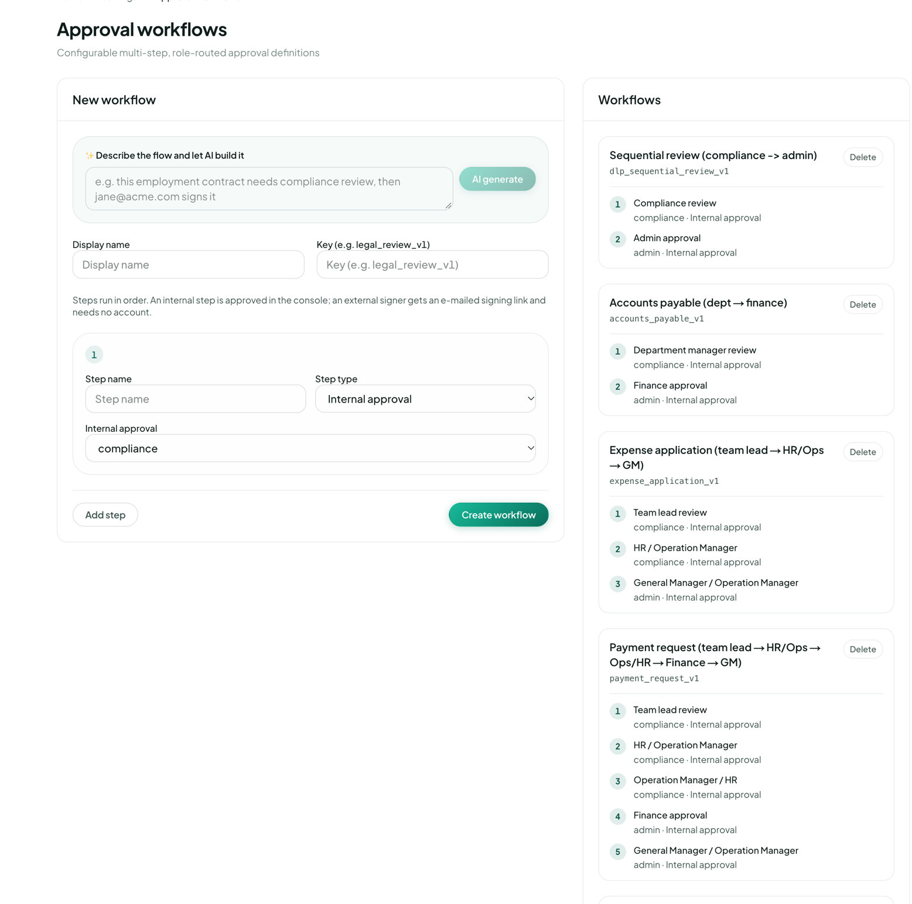

Work

# Workflow designer

<figure class="watch">
  <video controls preload="none" playsinline poster="https://visiondoc-tutorials.s3.ap-southeast-1.amazonaws.com/posters/18-workflow-designer.jpg" src="https://visiondoc-tutorials.s3.ap-southeast-1.amazonaws.com/videos/18-workflow-designer.mp4"></video>
  <figcaption>Watch the video</figcaption>
</figure>

**Workflow designer** is where a company administrator defines a workflow. The page title is **Approval workflows**. The line under it says **Configurable multi-step, role-routed approval definitions**.

<figure class="shot">
  
  <figcaption>The builder is empty. Four workflows are already saved.</figcaption>
</figure>

The page is two cards. **New workflow** makes one. **Workflows** is the list of ones already saved. An empty list says **No workflows**.

## New workflow

The first box says **Describe the flow and let AI build it**. The grey example is an employment contract that needs a compliance review, and then jane@acme.com signs it. That address is an example on the screen. It is not an account at this company. **AI generate** fills the display name, the key, and the steps from the sentence you type. It does not save. You still check the steps and click **Create workflow**.

Fill the card yourself the same way.

| Control | What it is |
|---|---|
| Display name | The name people see, such as Accounts payable (dept → finance) |
| Key | The id, such as `accounts_payable_v1`. The list uses this to tell workflows apart |
| Step name | The name of this step, such as Finance approval |
| Step type | Who acts. The three choices are below |
| The next menu | For an internal step, the role. For an external step, the email |
| Add step | Another step, numbered 2, then 3 |
| Create workflow | Save. A workflow needs a key, a name, and at least one step that has a name |

The line under the key says **Steps run in order. An internal step is approved in the console; an external signer gets an e-mailed signing link and needs no account.** Step 2 does not start until step 1 is done.

**Step type** has three choices.

| Type | Who acts |
|---|---|
| Internal approval | Someone with a role on their account approves it in the console. The roles in the menu are **compliance**, **admin**, and **uploader** |
| External signature | An email address. That person gets a signing link and does not need a VisionDoc account |
| JavaScript job | A short script on that step. It returns JSON. None of the saved workflows in the picture use this |

The role is not the step name. **Department manager review** can still say **compliance** underneath. The name is the label. The role is who can approve it. Those three roles are set on each person in [People & access](people.md).

A saved workflow is not edited in this list. A change is a new workflow, with its own key. **Delete** removes that workflow so [Start workflow](start-workflow.md) can no longer offer it.

## Workflows

Each saved workflow shows its name, its key, the steps in order, and **Delete**. Under each step, the first word is the role and the rest is the step type. In this picture every step is **Internal approval**.

### Sequential review (compliance → admin)

Key `dlp_sequential_review_v1`.

| Step | Name | Who approves |
|---|---|---|
| 1 | Compliance review | compliance |
| 2 | Admin approval | admin |

A person with the compliance role reviews it. Then a person with the admin role approves it.

### Accounts payable (dept → finance)

Key `accounts_payable_v1`. This is the path for a supplier invoice.

| Step | Name | Who approves |
|---|---|---|
| 1 | Department manager review | compliance |
| 2 | Finance approval | admin |

The first step is named for the department manager. The person who can approve it is anyone with the compliance role. Finance approval is anyone with the admin role.

### Expense application (team lead → HR/Ops → GM)

Key `expense_application_v1`. This is the path for the expense form.

| Step | Name | Who approves |
|---|---|---|
| 1 | Team lead review | compliance |
| 2 | HR / Operation Manager | compliance |
| 3 | General Manager / Operation Manager | admin |

The first two steps are both the compliance role. The step name tells them apart. The last step is the admin role.

### Payment request (team lead → HR/Ops → Ops/HR → Finance → GM)

Key `payment_request_v1`.

| Step | Name | Who approves |
|---|---|---|
| 1 | Team lead review | compliance |
| 2 | HR / Operation Manager | compliance |
| 3 | Operation Manager / HR | compliance |
| 4 | Finance approval | admin |
| 5 | General Manager / Operation Manager | admin |

Five steps, in that order. The first three are the compliance role. The last two are the admin role.

Example: a quotation should go to a manager, then to the customer to sign. Display name **Quotation approval**. Key `quotation_approval_v1`. Step 1, **Manager approval**, type **Internal approval**, role **admin**. **Add step**. Step 2, **Customer signature**, type **External signature**, and the customer's email. **Create workflow**. It appears under **Workflows**. [Start workflow](start-workflow.md) can then open it and attach the PDF from **Quotation**.
