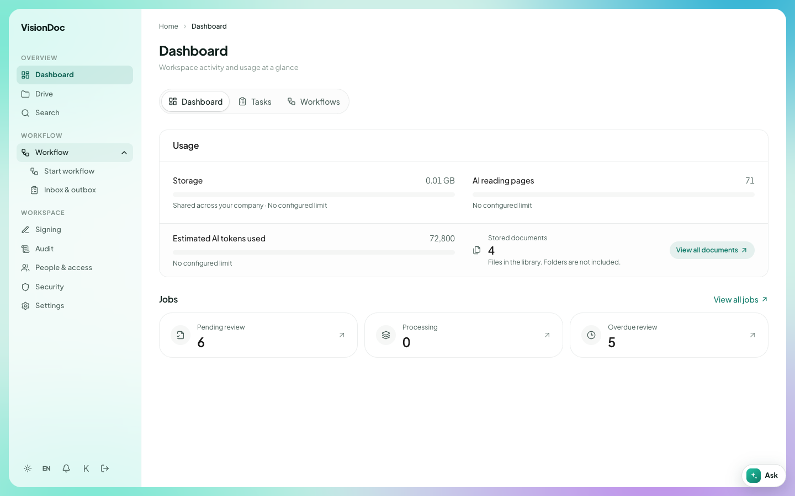
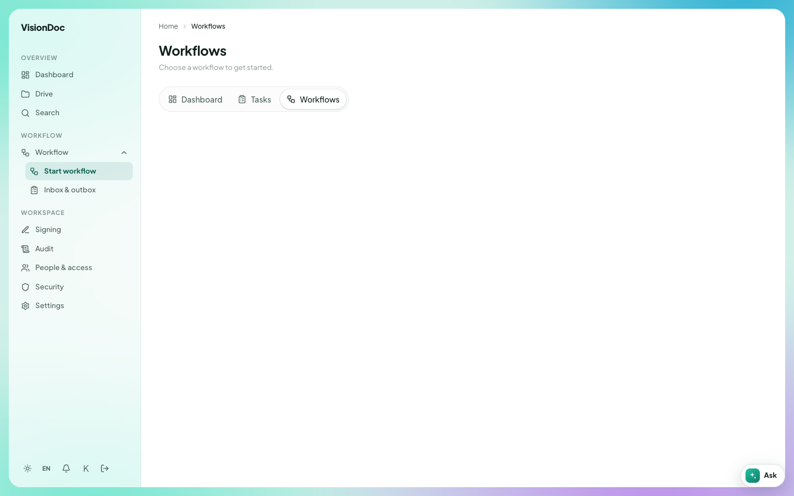
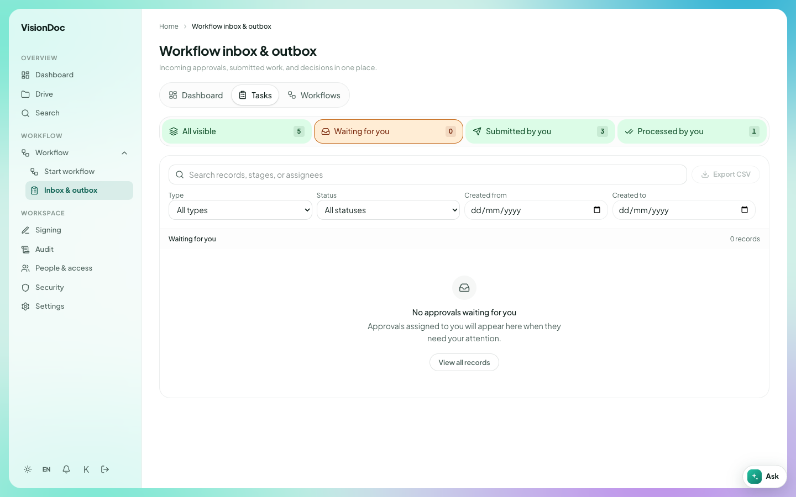
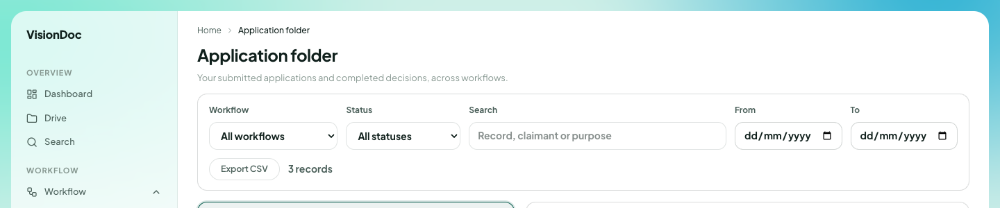

Work

# Workflow

**Workflow** is the row with a chevron, under the WORKFLOW heading. Click the row. The chevron turns up and the menu opens. The row itself is not a page.

<figure class="shot">
  
  <figcaption>The menu on this company: Start workflow and Inbox &amp; outbox.</figcaption>
</figure>

On the company in the pictures, the open menu has two items.

| Item | What you do there |
|---|---|
| Start workflow | Pick a workflow and begin it |
| Inbox & outbox | See work waiting for you, work you sent, and work you already decided |

**Application folder** is another page in the same group when the company uses it. It is not in this menu picture.

## Start workflow

**Start workflow** opens **Workflows**. The line under the title says **Choose a workflow to get started.**

<figure class="shot">
  
  <figcaption>No workflow is set up on this company yet, so the list is empty.</figcaption>
</figure>

The same three tabs sit here as on the dashboard: **Dashboard**, **Tasks**, and **Workflows**. **Workflows** is the one selected.

Example: a salesperson has a quotation PDF in **Quotation** and needs a manager to approve it. They open **Start workflow**, pick the quotation workflow the company has set up, and attach that PDF. The run then shows up in **Inbox & outbox** for the manager. This company has no workflow in the list yet, so there is nothing to pick.

## Inbox & outbox

**Inbox & outbox** is the list of runs already moving. The title is **Workflow inbox & outbox**. The line under it says **Incoming approvals, submitted work, and decisions in one place.**

<figure class="shot">
  
  <figcaption>Waiting for you is selected. This account has nothing to approve.</figcaption>
</figure>

Four counts sit across the top. The picture shows:

| Count | In the picture |
|---|---|
| All visible | 5 |
| Waiting for you | 0 |
| Submitted by you | 3 |
| Processed by you | 1 |

**Waiting for you** is selected, and the list says **No approvals waiting for you.** The line under that says **Approvals assigned to you will appear here when they need your attention.** **View all records** leaves that empty filter.

**Tasks** on the dashboard opens this same list, with the **Tasks** pill selected.

The search box reads **Search records, stages, or assignees**. **Type** is **All types**. **Status** is **All statuses**. **Created from** and **Created to** take a date. **Export CSV** downloads the list you are looking at.

Example: the manager opens **Inbox & outbox**, leaves **Waiting for you** selected, and approves the quotation. After that, **Waiting for you** goes back to 0 and **Processed by you** goes up by one. The salesperson opens the same page, selects **Submitted by you**, and sees the three they already sent. To see only what is still open, set **Status** away from **All statuses**.

## Application folder

**Application folder** is the list of applications and the decision on each one. The line under the title says **Your submitted applications and completed decisions, across workflows.**

<figure class="shot">
  
  <figcaption>Filters across the top. The record rows are left out of this picture.</figcaption>
</figure>

| Control | What it does |
|---|---|
| Workflow | **All workflows**, or one workflow |
| Status | **All statuses**, or one status |
| Search | **Record, claimant or purpose** |
| From / To | A date range |
| Export CSV | Downloads the rows that match |

The picture says **3 records**. The rows themselves are not in the book.

Example: a quotation was submitted last week and you only want the ones still open. Set **Status** off **All statuses**, type a word from the purpose, and set **From** and **To** to that week. **Export CSV** saves those rows. **3 records** in the picture is this company's count, not a limit.
