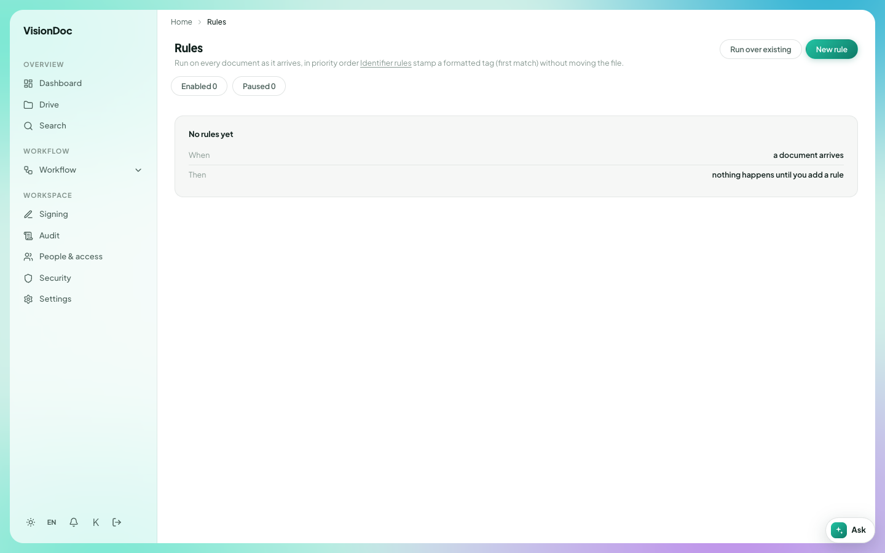
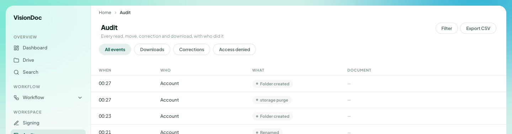
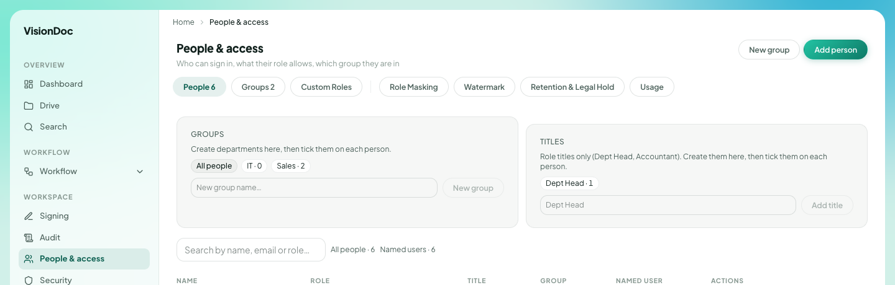
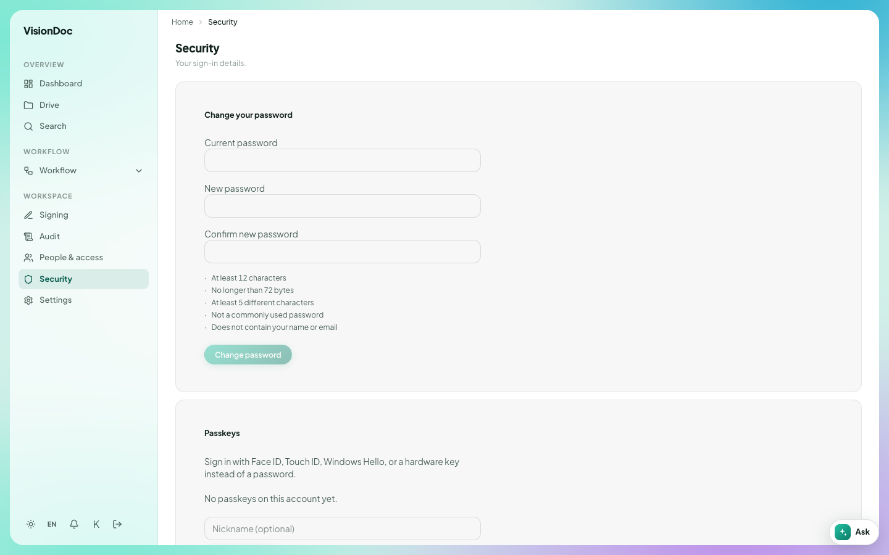
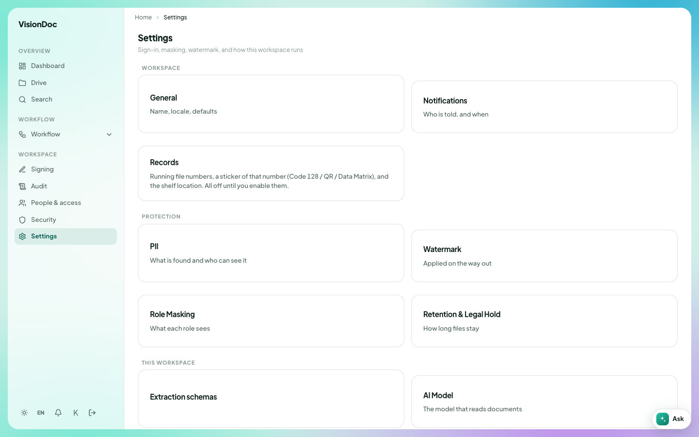

Sidebar

# Workspace

**Workspace** is the lower group in the sidebar. In the pictures it is **Signing**, **Audit**, **People & access**, **Security**, and **Settings**. Company administrators see the setup items. Other people see what their role allows.

**Signing** has its own page. The rest of the group is below. **Rules** is a separate page for filing incoming documents. It is not a row in the sidebar pictures of this company.

## Rules

**Rules** runs on every document as it arrives, in priority order. The line under the title says identifier rules stamp a formatted tag on the first match, and they do not move the file.

<figure class="shot">
  
  <figcaption>No rules yet. Enabled 0, Paused 0.</figcaption>
</figure>

The empty card says **No rules yet**. The two lines under that are **When a document arrives** and **Then nothing happens until you add a rule**. **Enabled** is 0. **Paused** is 0.

**New rule** adds one. **Run over existing** applies the rules to documents already in Drive.

Example: invoices should carry a tag such as `INV-2026` as soon as they land, without anyone moving the file. Add that as a rule with **New rule**. Until you do, a new file arrives and nothing happens, which is what the empty card says. After the rule is on, **Enabled** becomes 1. **Run over existing** stamps the invoices already in the library. Pause a rule when you want it to stop without deleting it, and **Paused** goes up by one.

## Audit

**Audit** reads **Every read, move, correction and download, with who did it**.

<figure class="shot">
  
  <figcaption>Four events. The document column is empty in these rows. Later rows are left out.</figcaption>
</figure>

Four filters sit under the title: **All events**, **Downloads**, **Corrections**, and **Access denied**. **Filter** narrows the list further. **Export CSV** downloads it.

The columns are **When**, **Who**, **What**, and **Document**. In the picture, **Who** is **Account** on each row. **What** is **Folder created**, **storage purge**, **Folder created** again, and **Renamed**. The times are 00:27, 00:27, 00:23, and 00:21. **Document** is a dash on these rows.

Example: someone says a folder appeared overnight. Open **Audit**, leave **All events** selected, and read the **Folder created** rows. To see only files that left the workspace, select **Downloads**. **Export CSV** keeps a copy of that view. The picture stops before any file name.

## People & access

**People & access** says **Who can sign in, what their role allows, which group they are in**.

<figure class="shot">
  
  <figcaption>Groups and titles. The person rows are left out of this picture.</figcaption>
</figure>

**New group** and **Add person** are at the top right.

| Tab | In the picture |
|---|---|
| People | 6 |
| Groups | 2 |
| Custom Roles | Roles you add |
| Role Masking | What each role sees |
| Watermark | A mark on the way out |
| Retention & Legal Hold | How long files stay |
| Usage | Storage and reading for this company |

**Groups** says **Create departments here, then tick them on each person.** The chips are **All people**, **IT · 0**, and **Sales · 2**. The box reads **New group name…**.

**Titles** says **Role titles only (Dept Head, Accountant). Create them here, then tick them on each person.** The picture has **Dept Head · 1**.

The table columns are **Name**, **Role**, **Title**, **Group**, **Named user**, and **Actions**. The search box reads **Search by name, email or role…**. The line beside it says **All people · 6** and **Named users · 6**.

Example: two people work in sales. **Sales · 2** is that group. Type a new department in **New group name…** and click **New group**, then tick it on each person. **Dept Head · 1** means one person already has that title. Add another title in the **Titles** box, click **Add title**, and tick it on the person who should have it. The names are not in this picture.

## Security

**Security** is **Your sign-in details.** It is your own account, not the company list.

<figure class="shot">
  
  <figcaption>Change your password. This account has no passkey yet.</figcaption>
</figure>

**Change your password** asks for **Current password**, **New password**, and **Confirm new password**. The new password has to be:

- At least 12 characters
- No longer than 72 bytes
- At least 5 different characters
- Not a commonly used password
- Not containing your name or email

**Change password** saves it.

**Passkeys** lets you sign in with Face ID, Touch ID, Windows Hello, or a hardware key instead of a password. The picture says **No passkeys on this account yet.** **Nickname (optional)** is the name you give that key.

Example: replace a short password with one of 12 characters that does not contain your name. Type it twice, then click **Change password**. To stop typing it, add a passkey on this same page and give it a nickname such as "Office laptop". The sign-in page then offers **Sign in with a passkey**.

## Settings

**Settings** reads **Sign-in, masking, watermark, and how this workspace runs**.

<figure class="shot">
  
  <figcaption>The company workspace. Records stay off until someone turns them on.</figcaption>
</figure>

| Card | What it is |
|---|---|
| General | Name, locale, defaults |
| Notifications | Who is told, and when |
| Records | Running file numbers, a sticker of that number (Code 128 / QR / Data Matrix), and the shelf location. All off until you enable them |
| PII | What is found and who can see it |
| Watermark | Applied on the way out |
| Role Masking | What each role sees |
| Retention & Legal Hold | How long files stay |
| Extraction schemas | How fields are read off a document |
| AI Model | The model that reads documents |

Example: the company wants Traditional Chinese as the default. Open **General** and set the locale there. To put a running number on each new file, open **Records** and turn that on. Until then the card stays off, which is what the picture says. **Notifications** is where you choose who hears about a file that needs review, and when.
