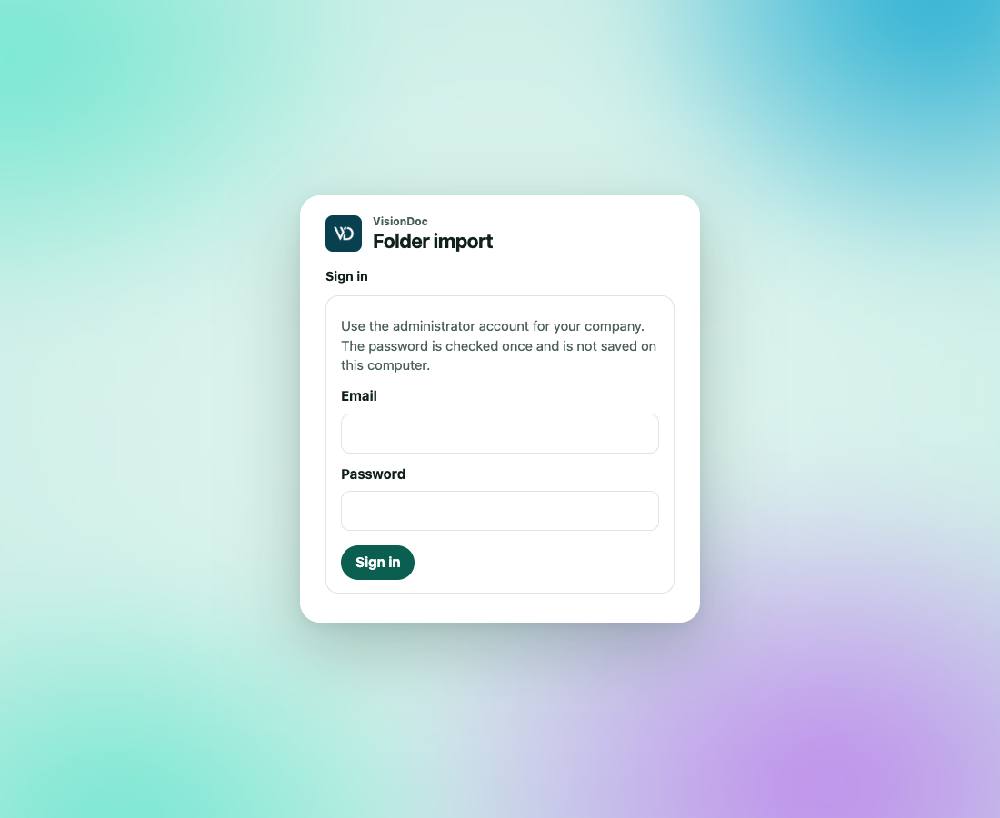

<p class="kicker">This computer</p>

# Folder import

Folder import is a small program you run on a computer that can see the folder. It signs in to production VisionDoc at [https://app.visiondoc.ai](https://app.visiondoc.ai), reads the folder, and uploads new documents. It does not change or delete the files in the source folder.

<figure class="shot">
  
  <figcaption>The setup page on the computer that runs the importer. It stays light.</figcaption>
</figure>

The program is the public image [ghcr.io/kaff-international-limited/visiondoc-smb](https://github.com/kaff-international-limited/visiondoc-smb/pkgs/container/visiondoc-smb). It talks only to production. No GitHub login is required to pull it.

## What you need

- Docker.
- A company administrator account on production VisionDoc.
- Your company must already be allowed to pair an importer. If sign-in says the company is not enabled, ask the person who runs VisionDoc for your company.
- A read-only account on the folder is enough.

## Start it

On the computer that should do the importing:

```sh
docker pull ghcr.io/kaff-international-limited/visiondoc-smb:latest

docker run -d --name visiondoc-smb \
  --restart unless-stopped \
  -p 127.0.0.1:8787:8080 \
  -v visiondoc-smb:/data \
  --read-only \
  --tmpfs /tmp:size=64m,mode=1777 \
  --cap-drop ALL \
  --security-opt no-new-privileges:true \
  --memory 512m \
  ghcr.io/kaff-international-limited/visiondoc-smb:latest
```

Then open **http://localhost:8787** on that same computer. If that port is taken, change the first number, for example `-p 127.0.0.1:8788:8080`.

The setup page is light, and it stays light. It is separate from the theme you pick in the VisionDoc console.

## Connect the company

1. Enter the administrator email and password.
2. Click **Sign in**.

The password is checked once and is not saved on the computer. VisionDoc returns a token that the importer keeps. Browser sign-in on this page lasts up to 30 days.

## Choose the folder

1. Pick a protocol: **SMB**, **SFTP**, **FTPS**, or **WebDAV**.
2. Enter the folder.
   - SMB uses a UNC path, such as `\\server\share\folder`.
   - SFTP uses `sftp://files.example/inbox`.
   - FTPS uses `ftps://files.example/inbox`.
   - WebDAV uses an `https://` address.
3. Enter the username and password for that folder. For SMB you can use `DOMAIN\username`.
4. Click **Test connection and save**.
5. Click **Start import**.

Plain FTP and plain HTTP are refused. The page tells you the address shape for the protocol you picked.

Files larger than 64 MB stay in the folder and are not uploaded. Every subfolder is included.

## What the status means

The three steps at the top are **Company**, **Folder**, and **Import**.

| Mark | Meaning |
|---|---|
| Importing | A scan is running |
| Paused | The scan is stopped |
| Ready | The folder is saved and has not been scanned yet |
| Imported | That file is now a VisionDoc document |
| Unchanged | The same content was already imported |
| Skipped | A duplicate of content already imported |
| Waiting | The file was still changing, so this scan left it |
| Failed | That file was not uploaded. The reason is on the row |

Identical content is uploaded once, even if the file is renamed. A changed file becomes a new document. Removing a file from the folder does not delete the document in VisionDoc.

Refresh the page to update the list. **Scan again** runs another pass. **Pause** stops the scan.

## Sign out and restart

**Sign out** only hides this setup screen. Import keeps running. The note under the button says **Hides this screen only. Import keeps running.**

`docker restart visiondoc-smb`, or a restart of the computer, keeps the saved folder, the token, and the list of what was already imported. Docker has to start on that computer. Do not remove the `visiondoc-smb` volume unless you mean to set the importer up again from the beginning.

The setup page listens on this computer only. Do not publish port 8787 on the internet. For remote use, put a secured HTTPS proxy in front of it.
