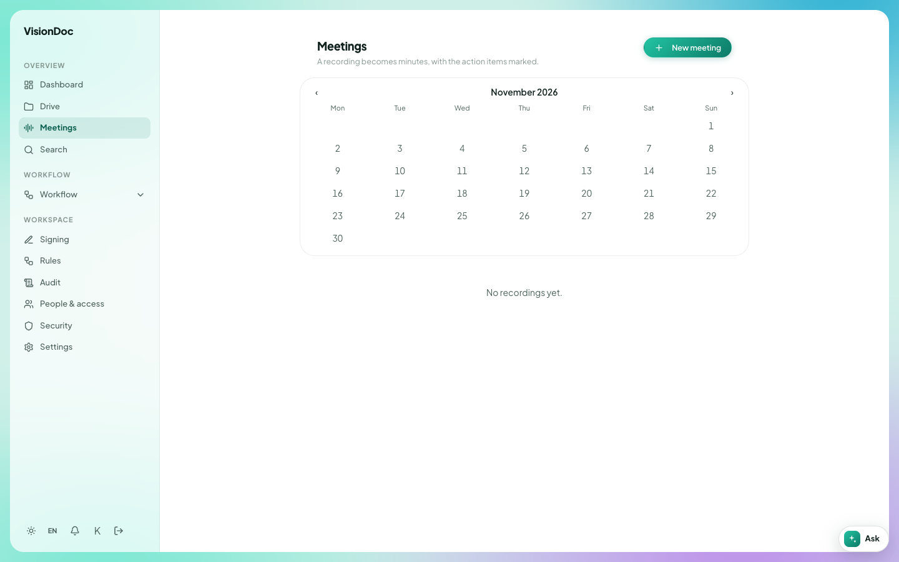

Recordings

# Meetings

Open **Meetings** under Overview.

<figure class="shot">
  
  <figcaption>Meetings. A recording becomes minutes, with the action items marked.</figcaption>
</figure>

**New meeting** starts a recording from this computer. The browser asks for the microphone the first time.

The calendar is the month you are looking at. Pick a day to see what was recorded then. If that company has no recordings yet, the page says **No recordings yet.**

Open a meeting in the list to read the minutes VisionDoc made from it.
