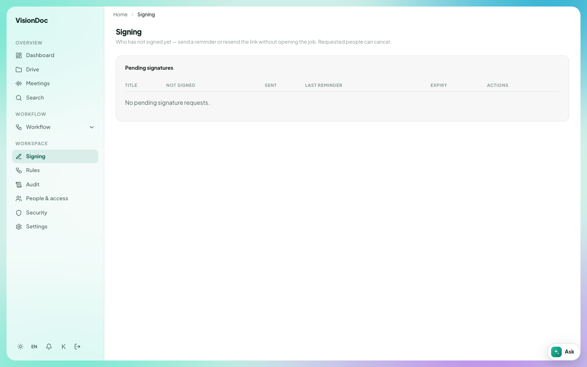

Signatures

# Signing

Open **Signing** under Workspace.

<figure class="shot">
  
  <figcaption>Pending signatures. This company has none waiting.</figcaption>
</figure>

The page says who has not signed yet. From here you can send a reminder or resend the link without opening the job. Requested people can cancel.

The table is **Title**, **Not signed**, **Sent**, **Last reminder**, **Expiry**, and **Actions**. An empty list says **No pending signature requests.**

You only see requests for your company. Open a row when one is waiting, review the document, and sign it.

A drop-off link in Drive can also ask for a signature after a guest uploads. That option is **Then request e-sign**.
