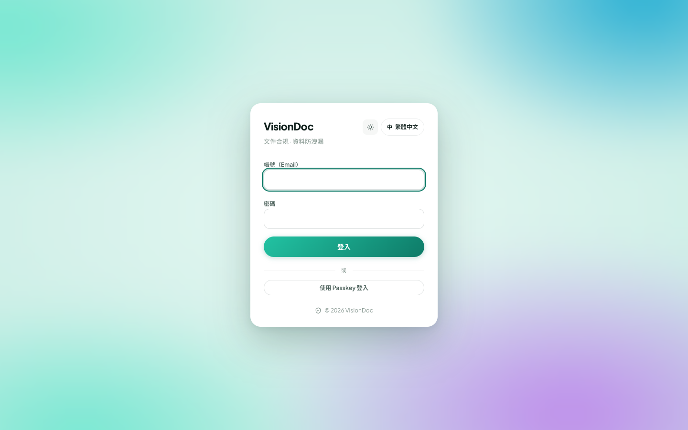
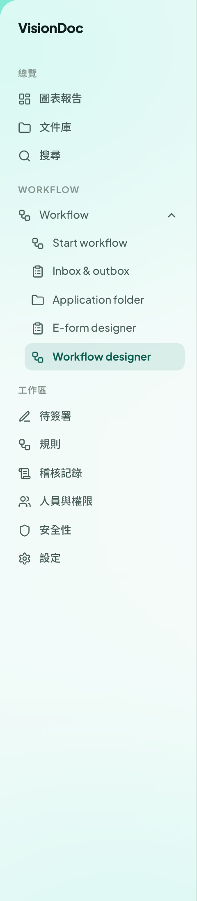

<a href="../en/index.html">English</a>

# 點用 VisionDoc

<figure class="watch">
  <video controls preload="none" playsinline poster="https://visiondoc-tutorials.s3.ap-southeast-1.amazonaws.com/posters/01-how-to-use-visiondoc.jpg" src="https://visiondoc-tutorials.s3.ap-southeast-1.amazonaws.com/videos/01-how-to-use-visiondoc.mp4"></video>
  <figcaption>看短片。這段短片和字幕都是英文。</figcaption>
</figure>

VisionDoc 是公司的文件工作區。登入之後，先看有甚麼要處理，文件就放在文件庫。

  <a class="card card-sign" href="sign-in.html">
    <strong>登入</strong>
    用公司給的帳號打開主控台。
  </a>
  <a class="card card-drive" href="drive.html">
    <strong>文件庫</strong>
    Home 裡面是 Invoice、Quotation 和 Sales Order。
  </a>
  <a class="card card-flow" href="start-workflow.html">
    <strong>Workflow</strong>
    開始一次流程、看收件箱，或者設計表單和流程。
  </a>
  <a class="card card-import" href="folder-import.html">
    <strong>資料夾匯入</strong>
    從網絡上的資料夾把文件匯入。
  </a>

打開 **[https://app.visiondoc.ai](https://app.visiondoc.ai)**。這本說明有英文和繁體中文。主控台左下角的 **中** 和 **EN** 用來轉語言。

<figure class="shot">
  
  <figcaption>正式環境的登入頁，繁體中文。</figcaption>
</figure>

## 東西放在邊

側欄有三組。

| 組 | 項目 |
|---|---|
| 總覽 | 圖表報告、文件庫、搜尋 |
| Workflow | 一個選單：Start workflow、Inbox & outbox、Application folder、E-form designer、Workflow designer |
| 工作區 | 待簽署、規則、稽核記錄、人員與權限、安全性、設定 |

**Workflow** 那一行右邊有一個箭嘴。點下去，箭嘴轉向上，下面就是整個 Workflow 組。每一項在這本說明裡都有自己的一頁。側欄上這幾項的名稱在繁體中文介面仍然是英文。總覽和工作區會轉成中文。

<figure class="shot">
  
  <figcaption>主控台選單。Workflow 是打開的。選中的是 Workflow designer。</figcaption>
</figure>

公司管理員看得到設定那些項：E-form designer、Workflow designer、規則、人員與權限、設定。其他角色只看到自己允許的項目。

太陽圖示轉淺色和深色。**中** 轉語言。門的圖示是登出。**詢問** 在每一頁的右下角。

這些畫面是 2026 年 11 月在正式環境拍的。有些按鈕的產品名稱仍然是英文，說明會跟畫面上一樣寫。
