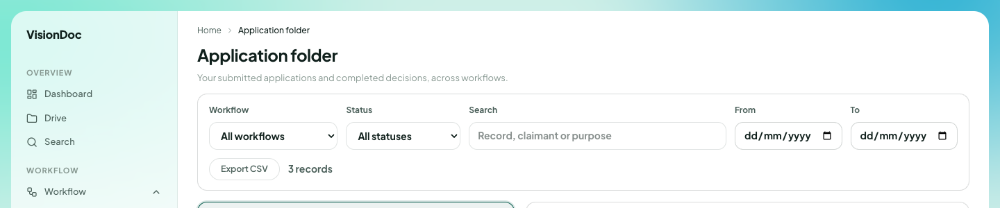

工作

# Application folder

<figure class="watch">
  <video controls preload="none" playsinline poster="https://visiondoc-tutorials.s3.ap-southeast-1.amazonaws.com/posters/16-application-folder.jpg" src="https://visiondoc-tutorials.s3.ap-southeast-1.amazonaws.com/videos/16-application-folder.mp4"></video>
  <figcaption>看短片。這段短片和字幕都是英文。</figcaption>
</figure>

**Application folder** 是大家交過的申請，以及每一份的決定。這個名稱在中文畫面仍然是英文。標題下面寫 **Your submitted applications and completed decisions, across workflows.**

<figure class="shot">
  
  <figcaption>上面是篩選。記錄本身沒有放進這張圖。</figcaption>
</figure>

| 控制 | 做甚麼 |
|---|---|
| Workflow | **All workflows**，或選一條流程 |
| Status | **All statuses**，或選一個狀態 |
| Search | **Record, claimant or purpose** |
| From / To | 開始日期和結束日期 |
| Export CSV | 下載對得上的列 |

這張圖寫 **3 records**。那些列沒有放進說明裡。

你想看上星期還未完成的報價。把 **Status** 離開 **All statuses**。打用途裡的一個字。把 **From** 和 **To** 設成那個星期。**Export CSV** 把那些列存下來。**3 records** 是這家公司的數目，不是上限。
