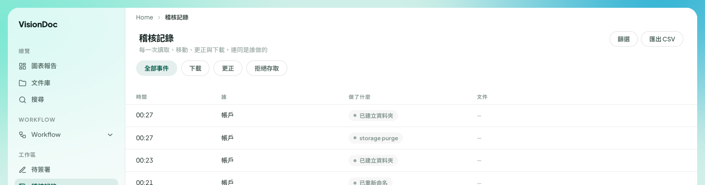

工作區

# 稽核記錄

<figure class="watch">
  <video controls preload="none" playsinline poster="https://visiondoc-tutorials.s3.ap-southeast-1.amazonaws.com/posters/21-audit.jpg" src="https://visiondoc-tutorials.s3.ap-southeast-1.amazonaws.com/videos/21-audit.mp4"></video>
  <figcaption>看短片。這段短片和字幕都是英文。</figcaption>
</figure>

**稽核記錄** 的副題是 **每一次讀取、移動、更正與下載，連同是誰做的**。

<figure class="shot">
  
  <figcaption>四筆事件。這幾列的文件欄是空的。後面的列沒有放進畫面。</figcaption>
</figure>

標題下面有四個篩選：**全部事件**、**下載**、**更正**、**拒絕存取**。**篩選** 再收窄。**匯出 CSV** 下載這張清單。

欄是 **時間**、**誰**、**做了什麼**、**文件**。畫面裡每一列的 **誰** 都是 **帳戶**。**做了什麼** 是 **已建立資料夾**、**storage purge**、再一次 **已建立資料夾**，和 **已重新命名**。時間是 00:27、00:27、00:23、00:21。這幾列的 **文件** 是一條橫線。

例子：有人說夜裡多了一個資料夾。打開 **稽核記錄**，留在 **全部事件**，看 **已建立資料夾** 那幾列。如果只想看離開工作區的文件，選 **下載**。**匯出 CSV** 留一份這個畫面。這張圖在任何檔名出現之前就裁掉了。
