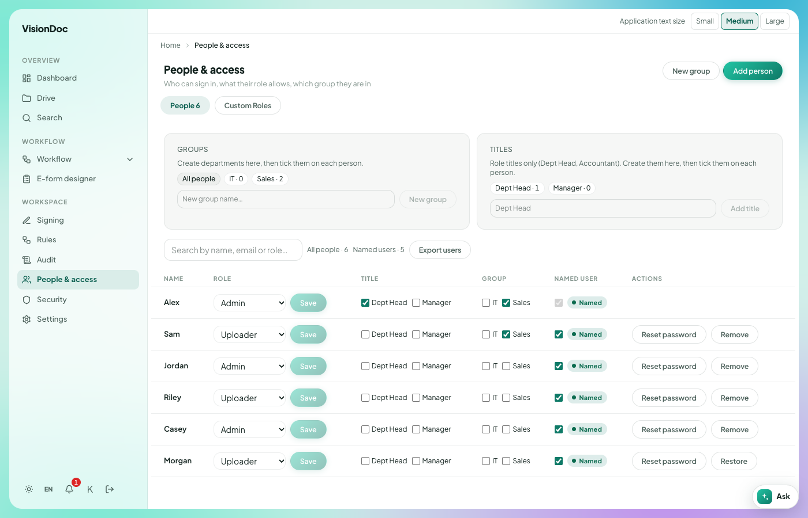

工作區

# 更換管理員

**更換管理員** 是把一個人設成 **Admin**，或者拿走 **Admin**。在 **People & access** 做。密碼保持不變。

用一個 **Admin** 帳戶登入 [app.visiondoc.ai](https://app.visiondoc.ai)。打開 **People & access**。

找到那個人。在 **Role** 打開選單。**Built-in roles** 是 **Admin**、**Compliance**、**Uploader**。這家公司如果有 **Custom roles**，會列在下面。

選 **Admin**。在同一列按 **Save**。角色沒有改之前，**Save** 是停用的。

VisionDoc 會把那個人登出。他再登入，新角色才生效。畫面寫 **Role saved. The user must sign in again for their new access.**

<figure class="shot">
  
  <figcaption>每一列都有 Role 和 Save。圖裡的人名是例子。</figcaption>
</figure>

## 把公司交給新的管理員

先把新的人設成 **Admin**，按 **Save**，才改自己的角色。

你在自己那一列儲存新角色時，VisionDoc 會送你回登入頁。

## 要注意的情況

只有 **Admin** 可以改角色。可以打開 Settings、而自己不是 **Admin** 的人，不能儲存角色。

**Save** 只改那一個人。

改自己之前，先留下另一個 **Admin**。這一頁不會自動留一個後備 **Admin**。最後一個 **Admin** 變成 **Uploader** 之後，就沒有人可以再改角色。

密碼保持不變。**Reset password** 是另一個按鈕，不會出現在你自己那一列。新密碼只顯示一次。直接交給那個人。他要先改成自己的密碼，才可以用主程式。

**Named** 和 **Admin** 是兩件事。只有 **Named** 用戶可以登入。**Non-Named** 不用 **Named** 席位。你不能關掉自己的 **Named**。

**Starter** 可以有 2 個 **Named** 用戶。**Advance** 可以有 5 個。已經超過的帳戶仍然留低。改角色不會多用一個席位。套裝已滿時，再加一個 **Named** 用戶會被拒絕。訊息寫 **This package allows 2 Named users. Create a Non-Named account or free a Named seat first.** Advance 那個數字是 5。沒有 **Named** 人數上限的公司，不會見到這句拒絕。

自訂角色不是內建的 **Admin**。兩個選一個。自訂角色仍然有一個底：**Admin**、**Compliance** 或 **Uploader**。

**Remove** 是另一個按鈕。它會停止那個人登入，稽核記錄仍然留低。你只想改誰是 **Admin**，用 **Role** 和 **Save**。

人還不在名單裡，按 **Add person**。在 **Create user** 把角色設成 **Admin**。他要登入的話，**User type** 選 **Named**。密碼至少 12 個字。直接交給他。
