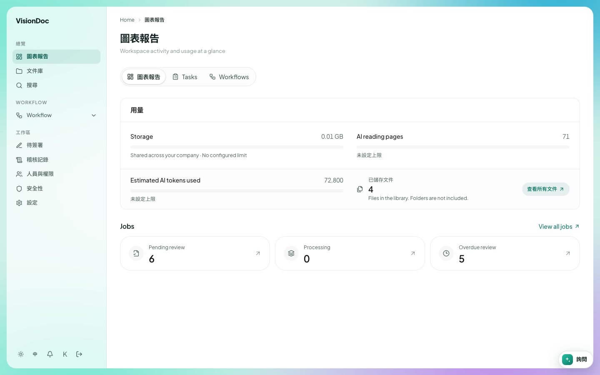

主頁

# 圖表報告

<figure class="watch">
  <video controls preload="none" playsinline poster="https://visiondoc-tutorials.s3.ap-southeast-1.amazonaws.com/posters/03-dashboard.jpg" src="https://visiondoc-tutorials.s3.ap-southeast-1.amazonaws.com/videos/03-dashboard.mp4"></video>
  <figcaption>看短片。這段短片和字幕都是英文。</figcaption>
</figure>

登入後第一頁是圖表報告。副題在繁體中文介面仍然是英文：**Workspace activity and usage at a glance**，即是一眼看到工作區在做甚麼、用了多少。

<figure class="shot">
  
  <figcaption>這家公司的數字。儲存空間幾乎是空的。三份文件在等。這張圖是英文畫面。下面會寫出繁體中文介面改了哪些字。</figcaption>
</figure>

## 三個分頁

標題下面有三個分頁。選中的是圖表報告。

| 分頁 | 去哪裡 |
|---|---|
| 圖表報告 | 這一頁。用量和工作數目。英文畫面寫 **Dashboard** |
| Tasks | 和 Inbox & outbox 同一張清單。派給你的工作。這個名稱仍然是英文 |
| Workflows | 你可以開始的流程，和 Start workflow 是同一頁。這個名稱仍然是英文 |

## 用量

**用量** 是分頁下面那一張卡。英文畫面寫 **Usage**。公司管理員看得到。其他人看到的是 **Workspace administrators can view usage and subscription details.**，即是用量和訂閱由管理員查看。

卡裡有四個數字。

### Storage

**Storage** 這個字仍然是英文。畫面是 **0.00 GB / 10.00 GB**。前面是文件庫用了多少，後面是上限。下面的橫條是用了幾多。這裡橫條是空的，因為 10.00 GB 裡用了 0.00 GB。

橫條下面寫 **10.00 GB shared across your company**，這句仍然是英文。意思是這 10.00 GB 是整家公司共用，不是每個人各自 10 GB。

### AI reading pages

**AI reading pages** 仍然是英文。畫面是 **2 / 500**。一頁是 VisionDoc 從文件讀過的一頁。這家公司可以讀 500 頁，已經讀了 2 頁。橫條裡那一點就是 500 頁之中的 2 頁。

### Estimated AI tokens used

**Estimated AI tokens used** 仍然是英文。畫面是 **5,600**。一個 token 是 AI 讀到的一小段文字。這個數字是公司用了多少這類讀取的估計。

英文畫面下面寫 **No configured limit**。繁體中文介面這句是 **未設定上限**。公司沒有為 token 設上限，所以 5,600 沒有「一共幾多」可以對。橫條保持灰色。

### 已儲存文件

**已儲存文件** 在英文畫面寫 **Stored documents**。畫面是 **5**。下面那句在英文畫面是 **Files in the library. Folders are not included.**，意思是算文件庫裡的檔案，資料夾不算。Invoice 這個資料夾本身不加進 5。裡面的一份 PDF 才算。

**查看所有文件** 打開文件庫。英文畫面寫 **View all documents**。

## Jobs

**Jobs** 這個標題仍然是英文。它在用量卡的下面。一個 job 是公司交進來、要讀的一份文件。

右邊的 **View all jobs** 仍然是英文。它打開完整清單。那一頁的標題是 **Jobs**。英文副題是 **Document processing job list · click a row for a quick preview**。繁體中文副題是 **文件處理工作列表 · 點擊列可快速預覽**。

下面有三張卡。每張卡都打開 Inbox & outbox。卡上的箭嘴就是那個連結。三個名稱在繁體中文介面仍然是英文。

| 卡 | 畫面 | 這個數字在數甚麼 |
|---|---|---|
| Pending | 3 | 還有人要看的文件。VisionDoc 已經讀完 |
| Processing | 0 | VisionDoc 還在讀的文件。讀取在文件進來時就做完，所以這個數字停在 0 |
| Submitted | 3 | 在 Pending 裡等了超過一天的文件 |

這張圖的 **Pending** 和 **Submitted** 都是 3。每一份在等的文件都已經等了超過一天。

例子：公司有 10.00 GB，還沒有用到。讀了兩頁，這次讀取估計是 5,600 個 token，而且沒有設 token 上限。文件庫有 5 份文件。其中 3 份在等人看，而且 3 份都等了超過一天。按 **Pending** 或 **Submitted** 就到 Inbox & outbox。按 **查看所有文件** 就在文件庫看到那 5 份。
