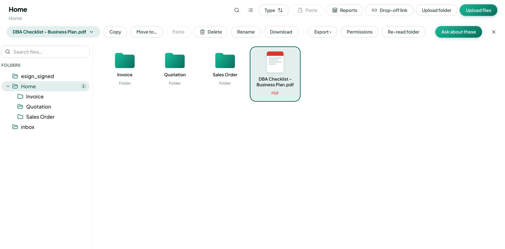

文件

# 上傳資料夾

<figure class="watch">
  <video controls preload="none" playsinline poster="https://visiondoc-tutorials.s3.ap-southeast-1.amazonaws.com/posters/11-upload-folder.jpg" src="https://visiondoc-tutorials.s3.ap-southeast-1.amazonaws.com/videos/11-upload-folder.mp4"></video>
  <figcaption>看短片。這段短片和字幕都是英文。</figcaption>
</figure>

<figure class="shot">
  
  <figcaption>上傳資料夾在上面一排。</figcaption>
</figure>

**上傳資料夾** 把電腦上的整個資料夾放進你打開的資料夾。那個資料夾保留自己的名字，裡面的檔案一起上來。英文畫面寫 **Upload folder**。

那個資料夾還在上傳的時候，**上傳資料夾** 會等。

你有一個叫 `2026` 的資料夾，裡面全是報價。打開 **Quotation**，按 **上傳資料夾**，選 `2026`。文件庫就會有 `Quotation / 2026`，檔案都在裡面。
