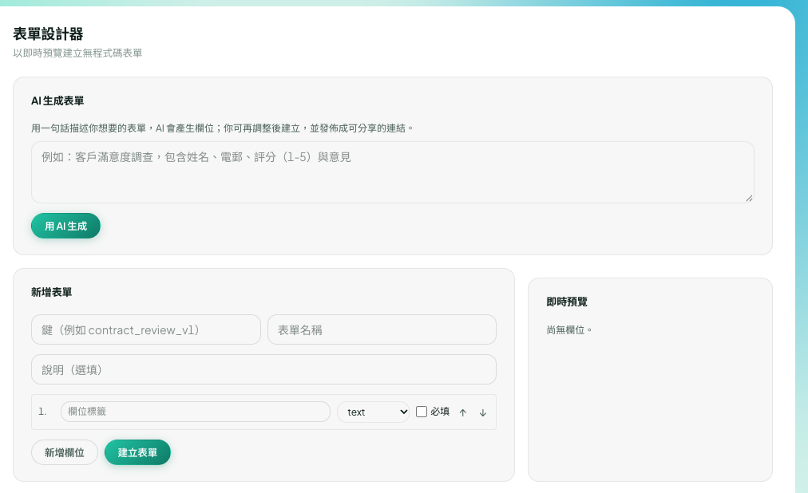

工作

# E-form designer

**E-form designer** 用來做一張表單，然後分享出去。側欄上的名稱仍然是英文。頁面標題是 **表單設計器**。下面寫 **以即時預覽建立無程式碼表單**。

<figure class="shot">
  
  <figcaption>還沒有填。即時預覽寫尚無欄位。</figcaption>
</figure>

**AI 生成表單** 收一句話。提示寫 **用一句話描述你想要的表單，AI 會產生欄位；你可再調整後建立，並發佈成可分享的連結。** 框裡已經有一個例子：客戶滿意度調查，包含姓名、電郵、評分（1–5）與意見。**用 AI 生成** 會按那句話填好 **新增表單**。

**新增表單** 也可以自己填。

| 欄 | 填甚麼 |
|---|---|
| 鍵 | 一個短名字，例如 `contract_review_v1` |
| 表單名稱 | 別人看到的名字 |
| 說明 | 可留空 |
| 欄位標籤 | 那一題，例如電郵 |
| 類型 | text、textarea、number、date、select、checkbox 或 image。類型的字仍然是英文 |
| 必填 | 這一題不能留空就勾上 |

**新增欄位** 再加一行。箭嘴把欄位上移或下移。類型選 **select** 時，還要填 **選項（逗號分隔）**。**即時預覽** 跟著你打的字畫出表單。欄位還沒有標籤時，它寫 **尚無欄位。** **建立表單** 儲存它。

存好的表單會出現在下面的 **表單** 清單。**建立分享連結** 做出一條不用 VisionDoc 帳戶也能打開的連結。**查看回應** 列出別人交回來的答案。

例子：用框裡那句滿意度調查，按 **用 AI 生成**，在 **即時預覽** 看欄位。標籤不對就改，電郵那一題勾 **必填**，然後按 **建立表單**。**建立分享連結** 就是寄給客戶的那條連結。他們的答案回到 **查看回應**。
