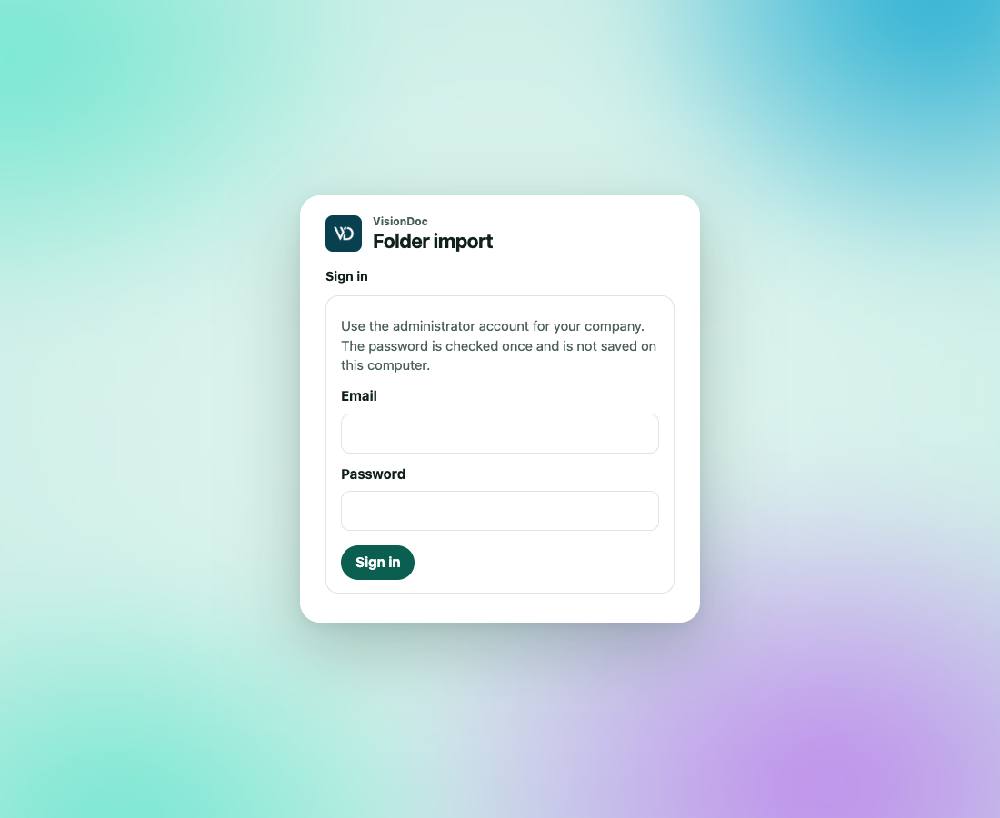

<p class="kicker">這部電腦</p>

# 資料夾匯入

<p>這頁有一段英文短片，字幕也是英文。<a href="https://visiondoc-tutorials.s3.ap-southeast-1.amazonaws.com/videos/26-folder-import.mp4">看短片</a></p>

資料夾匯入是一個小程式，放在看得到那個資料夾的電腦上。它登入正式環境 [https://app.visiondoc.ai](https://app.visiondoc.ai)，讀取資料夾，把新文件上傳。它不會改、也不會刪來源資料夾裡的檔案。

<figure class="shot">
  
  <figcaption>跑匯入程式的那部電腦上的設定頁。這頁維持英文，也維持淺色。</figcaption>
</figure>

程式是公開映像 [ghcr.io/kaff-international-limited/visiondoc-smb](https://github.com/kaff-international-limited/visiondoc-smb/pkgs/container/visiondoc-smb)。它只跟正式環境說話。拉取映像不用登入 GitHub。

設定頁的按鈕維持英文。下面用畫面上的英文名稱。

## 你需要甚麼

- Docker。不用 Compose。
- 正式環境上的公司管理員帳戶。
- 公司必須已經允許配對匯入程式。如果登入說公司未啟用，問負責 VisionDoc 的人。
- 資料夾用一個唯讀帳戶就夠。

## 啟動

在應該做匯入的那部電腦上：

```sh
docker pull ghcr.io/kaff-international-limited/visiondoc-smb:latest

docker run -d --name visiondoc-smb \
  --restart unless-stopped \
  -p 127.0.0.1:8787:8080 \
  -v visiondoc-smb:/data \
  --read-only \
  --tmpfs /tmp:size=64m,mode=1777 \
  --cap-drop ALL \
  --security-opt no-new-privileges:true \
  --memory 512m \
  ghcr.io/kaff-international-limited/visiondoc-smb:latest
```

然後在同一部電腦打開 **http://localhost:8787**。如果那個連接埠被佔用，改第一個數字，例如 `-p 127.0.0.1:8788:8080`。

設定頁是淺色，而且保持淺色。它跟 VisionDoc 主控台選的主題無關。這頁的文字維持英文。

## 連接公司

1. 輸入管理員的電郵和密碼。
2. 按 **Sign in**。

卡片寫 **Use the administrator account for your company. The password is checked once and is not saved on this computer.** 即是用公司管理員帳戶。密碼只核對一次，不會存在這部電腦。

VisionDoc 回傳一個權杖，由匯入程式保存。這個頁面的瀏覽器登入最長 30 日。

例子：公司管理員在看得到 `\\files\scan\inbox` 的辦公室電腦上登入。密碼不會寫進那部電腦的檔案。下次有人在同一部電腦打開 **http://localhost:8787**，公司仍然是連著的，直到 30 日過了，或者有人登出。

## 選資料夾

1. 選協定：**SMB**、**SFTP**、**FTPS** 或 **WebDAV**。
2. 輸入資料夾。
   - SMB 用 UNC 路徑，例如 `\\server\share\folder`。
   - SFTP 用 `sftp://files.example/inbox`。
   - FTPS 用 `ftps://files.example/inbox`。
   - WebDAV 用 `https://` 地址。
3. 輸入那個資料夾的使用者名稱和密碼。SMB 可以用 `DOMAIN\username`。
4. 按 **Test connection and save**。
5. 按 **Start import**。

純 FTP 和純 HTTP 會被拒絕。頁面會告訴你所選協定的地址格式。

大於 64 MB 的檔案留在資料夾，不會上傳。每一層子資料夾都會包括。

例子：掃描器把 PDF 放進 `\\files\scan\inbox`，`inbox\2026` 是子資料夾。選 **SMB**，輸入 `\\files\scan\inbox`，用唯讀帳戶，然後 **Test connection and save** 和 **Start import**。一份 2 MB 的發票會上傳。一份 90 MB 的掃描留在資料夾。`inbox\2026` 裡已有的檔案也會包括，因為每一層子資料夾都算。

## 狀態是甚麼意思

上面三步是 **Company**、**Folder**、**Import**。

| 標記 | 意思 |
|---|---|
| Importing | 正在掃描 |
| Paused | 掃描停了 |
| Ready | 資料夾已儲存，還沒掃描 |
| Imported | 那個檔案已經是 VisionDoc 的文件 |
| Unchanged | 同樣的內容已經匯入過 |
| Skipped | 內容跟已經匯入的重複 |
| Waiting | 檔案還在改變，這一次掃描留著它 |
| Failed | 那個檔案沒有上傳。原因在那一列 |

相同內容只上傳一次，就算檔案改了名。內容變了就成為一份新文件。從資料夾刪掉檔案，不會刪掉 VisionDoc 裡的文件。

重新整理頁面來更新清單。**Scan again** 再掃一次。**Pause** 停止掃描。

例子：`invoice-104.pdf` 匯入了，有人把它改名成 `invoice-104-signed.pdf`，頁面沒有改。下一次掃描標成 **Unchanged**，不會變成第二份文件。如果加了一頁簽名，下一次掃描會把新內容當成一份新文件。從共用資料夾刪掉那份 PDF，VisionDoc 裡的文件仍留在原處。

## 登出和重新啟動

**Sign out** 只是藏起這個設定畫面。匯入繼續跑。按鈕下面寫 **Hides this screen only. Import keeps running.** 即是只藏起這個畫面，匯入繼續。

`docker restart visiondoc-smb`，或者重新啟動電腦，會保留已存的資料夾、權杖，以及已經匯入了甚麼的清單。那部電腦的 Docker 要會自己啟動。不要刪 `visiondoc-smb` 這個 volume，除非你打算從頭再設定一次。

設定頁只聽這部電腦。不要把 8787 公開到網際網路。如果要從別的地方用，在前面放一個有保護的 HTTPS 代理。
