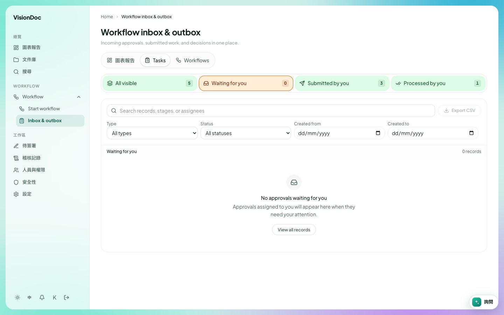

工作

# Inbox & outbox

<figure class="watch">
  <video controls preload="none" playsinline poster="https://visiondoc-tutorials.s3.ap-southeast-1.amazonaws.com/posters/15-inbox-and-outbox.jpg" src="https://visiondoc-tutorials.s3.ap-southeast-1.amazonaws.com/videos/15-inbox-and-outbox.mp4"></video>
  <figcaption>看短片。這段短片和字幕都是英文。</figcaption>
</figure>

**Inbox & outbox** 是已經在走的工作。標題是 **Workflow inbox & outbox**。下面寫 **Incoming approvals, submitted work, and decisions in one place.** 這些字在中文畫面仍然是英文。

<figure class="shot">
  
  <figcaption>選了 Waiting for you。沒有東西要你批。</figcaption>
</figure>

上面有四個數字。這張圖是：

| 數字 | 這張圖 |
|---|---|
| All visible | 5 |
| Waiting for you | 0 |
| Submitted by you | 3 |
| Processed by you | 1 |

選中的是 **Waiting for you**。清單寫 **No approvals waiting for you.** 下面那行寫 **Approvals assigned to you will appear here when they need your attention.** **View all records** 會清掉這個篩選。

圖表報告上的 **Tasks** 打開的是同一張清單。

搜尋框寫 **Search records, stages, or assignees**。**Type** 一開始是 **All types**。**Status** 一開始是 **All statuses**。**Created from** 和 **Created to** 是日期。**Export CSV** 下載你正在看的清單。

經理打開 **Inbox & outbox**，留在 **Waiting for you**，批准那份報價。**Waiting for you** 回到 0。**Processed by you** 加 1。營業員打開同一頁，按 **Submitted by you**，就看到自己已經送出的三份。
