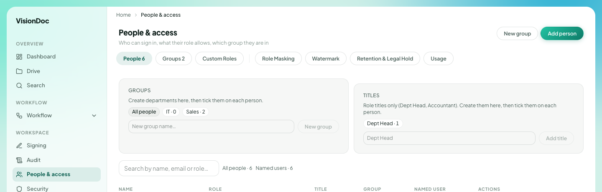

工作區

# 人員與權限

<figure class="watch">
  <video controls preload="none" playsinline poster="https://visiondoc-tutorials.s3.ap-southeast-1.amazonaws.com/posters/22-people-and-access.jpg?v=20261116" src="https://visiondoc-tutorials.s3.ap-southeast-1.amazonaws.com/videos/22-people-and-access.mp4?v=20261116"></video>
  <figcaption>看短片。這段短片和字幕都是英文。</figcaption>
</figure>

**人員與權限** 是誰可以登入、可以做甚麼、在哪一組。標題下面寫 **Who can sign in, what their role allows, which group they are in**。意思是「誰可以登入、角色允許做甚麼，以及所屬群組」。

<figure class="shot">
  
  <figcaption>組別和職銜。人名沒有放進這張圖。</figcaption>
</figure>

右上角是 **New group（新增群組）** 和 **Add person（新增人員）**。示範畫面保留英文，括號內是中文意思。

| 分頁 | 是甚麼 |
|---|---|
| People（人員） | 這張圖有 6 個人 |
| Groups（群組） | 這張圖有 2 組 |
| Custom Roles（自訂角色） | 你自己加的角色 |
| Role Masking（角色遮蔽） | 每個角色可以看甚麼 |
| Watermark（浮水印） | 檔案送出時加上的印 |
| Retention & Legal Hold（保留期與法律封存） | 檔案留多久。看 [記錄保留](retention.md) |
| Usage（用量） | 這家公司的儲存和讀取 |

**Groups（群組）** 寫 **Create departments here, then tick them on each person.** 那些標籤是 **All people**、**IT · 0**、**Sales · 2**。框裡寫 **New group name…**。

**Titles（職銜）** 寫 **Role titles only (Dept Head, Accountant). Create them here, then tick them on each person.** 這張圖有 **Dept Head · 1**。

表的直欄是 **Name（姓名）**、**Role（角色）**、**Title（職銜）**、**Group（群組）**、**Named user（具名使用者）**、**Actions（操作）**。搜尋框寫 **Search by name, email or role…**。旁邊寫 **All people · 6** 和 **Named users · 6**。

兩個人在銷售，所以那一組顯示 **Sales · 2**。在 **New group name…** 打新部門，按 **New group（新增群組）**，再在每個人身上剔選。**Dept Head · 1** 表示已經有一個人有這個職銜。再加一個職銜，按 **Add title（新增職銜）**，剔在該有的人身上。

要把一個人設成 **Admin（管理員）**，或者拿走 **Admin（管理員）**，看 [更換管理員](change-admin.md)。

角色指派、Union／Intersect、個人例外及資料夾／文件存取的步驟，請看 [權限：誰可以做甚麼](permissions.md)。敏感欄位的處理請看 [PII 與角色遮蔽](pii.md)。
