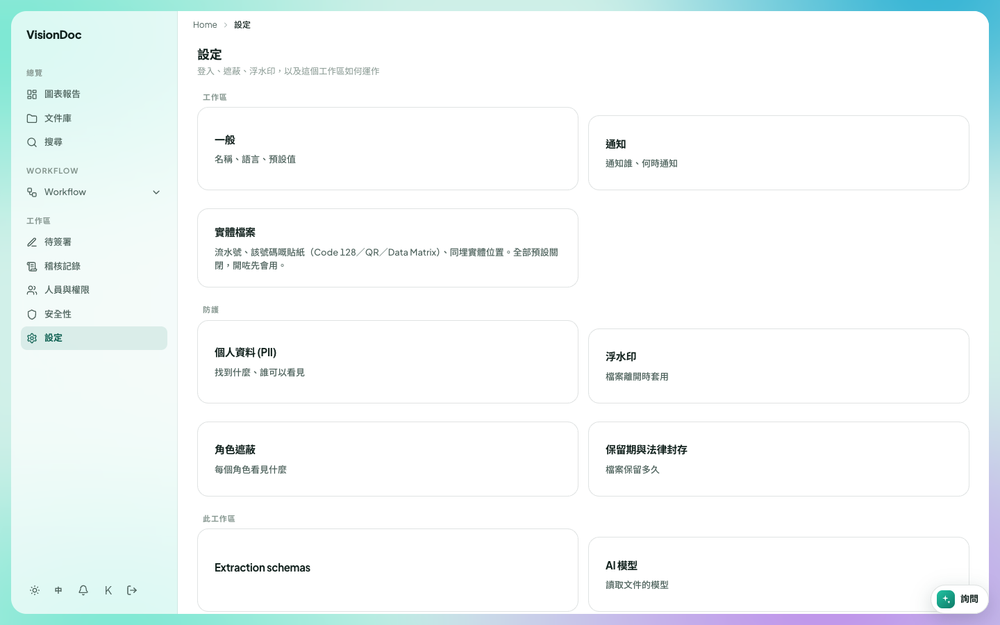

記錄

# 記錄保留

<figure class="watch">
  <video controls preload="none" playsinline poster="https://visiondoc-tutorials.s3.ap-southeast-1.amazonaws.com/posters/25-retention.jpg" src="https://visiondoc-tutorials.s3.ap-southeast-1.amazonaws.com/videos/25-retention.mp4"></video>
  <figcaption>看短片。這段短片和字幕都是英文。</figcaption>
</figure>

<figure class="shot">
  
  <figcaption>設定裡的保留期與法律封存。</figcaption>
</figure>

記錄保留是一份檔案留多久。你可以在文件庫為一個檔案或一個資料夾設定。管理公司的人也在設定裡定整家公司的規則。

## 保留期限

在文件庫右鍵一個檔案或一個資料夾。管理公司的人看得到 **保留期限**。英文畫面寫 **Keep period**。框的標題是 **保留期限**，後面是名稱。

框裡顯示現在的期限從哪裡來，以及檔案幾時到期。

| 一行 | 寫甚麼 |
|---|---|
| 來源 | **此檔案**、**資料夾**、**分類**、**租戶（全部）**、**AI 建議（未接受）**，或 **無** |
| 到期 | 一個日期，或 **無**。在法律保留中的檔案還會寫 **法律保留中** |

| 選擇 | 做甚麼 |
|---|---|
| 繼承（資料夾／租戶政策） | 這份檔案跟隨資料夾，或公司的規則。在資料夾上選這個，會清掉那個資料夾自己的預設 |
| 保留 N 日 | 按你打的日數保留。框一開始是 365 |
| 保留至指定日期 | 保留到你選的日期 |
| 永久保留 | 不讓期限到期 |

按 **儲存保留期限**。頁面寫 **已儲存保留期限**。

資料夾自己沒有預設的話，寫 **此資料夾沒有預設期限 — 檔案沿用租戶政策。**

文件讀完之後，AI 可以建議一個期限。框的標題是 **AI keep-period suggestion**，並顯示日數。**Accept suggestion** 就把那個期限用在這份檔案。建議不會自己被丟掉。設定頁的提示寫：建議永遠不會自動處置。

報價要留一年。右鍵 **Quotation**，選 **保留期限**，選 **保留 N 日**，留 365，按 **儲存保留期限**。**Quotation** 裡面的檔案就跟這一年，除非你再在檔案自己身上設一個期限。

## 保留期與法律封存

打開 **設定**，再打開 **保留期與法律封存**。頁面標題是 **Records retention & legal hold**。下面寫 **Retention policies, disposal sweep, and legal holds**。卡片上寫 **檔案保留多久**。

### AI 保留期限提示

**AI keep-period prompt** 是 AI 讀文件時用的指示。**Save prompt** 把它留下。留空的話，VisionDoc 用自己內置的表。提示寫發票 7 年、KYC 5 年。這個提示給出的建議，要有人按 **Accept suggestion** 才會用，不會自己丟掉。

### 保留政策

**Retention policies** 是公司規則的清單。**No policies yet** 表示清單是空的。

| 框 | 做甚麼 |
|---|---|
| 政策名稱 | 這條規則的名字 |
| 保留天數 | 這條規則把檔案留多少日 |
| 處置 | 期限到了，檔案可以被清走 |
| 標記 | 期限到了，檔案被標出，而且留下 |
| 所有文件 | 規則套用在每一份文件 |
| 依分類 | 規則套用在一個標籤，例如 RESTRICTED |
| 新增政策 | 儲存這條規則 |

### 法律保留

**Legal holds** 讓你點名的檔案不會被清走。**No legal holds** 表示現在沒有。

| 框 | 做甚麼 |
|---|---|
| 案件名稱 | 這次保留的名字 |
| 原因（選填） | 為甚麼要保留 |
| 工作 ID（逗號或換行分隔） | 這次保留覆蓋哪些檔案 |
| 設定保留 | 打開這次保留。狀態是 **生效中** |
| 解除 | 拿掉這次保留。狀態變成 **已解除** |

在保留中的檔案，保留期限框會寫 **法律保留中**。清走的那一步會跳過它。

### 預覽

**Retention preview** 數檔案：多少還在、多少已過期、多少在保留中、多少可以清走。**Nothing to preview** 表示沒有數字。

**Run disposal sweep** 清走預覽標出的檔案，並刪掉存著的檔案。頁面會先問。那句問話說這會永久處置那些記錄並刪除存著的檔案，而且不能復原。

稅務發票要留 7 年，其中一份合約有爭議。加一條政策，名稱 `Tax invoices`，2555 日，選 **處置**，再選 **依分類**。為那一份合約設保留，名稱 `Contract dispute`。掃走的時候，過了 2555 日的發票可以清走。那份合約留下，因為它在保留中。
