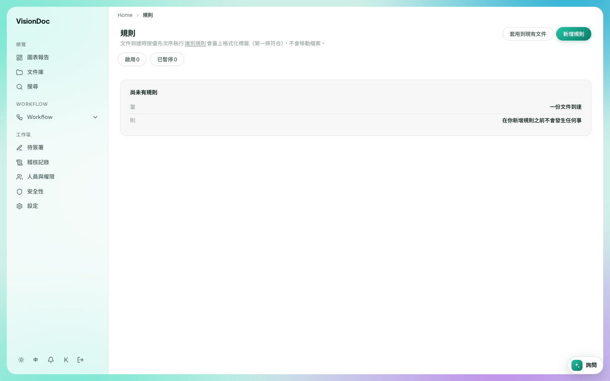

工作區

# 規則

<figure class="watch">
  <video controls preload="none" playsinline poster="https://visiondoc-tutorials.s3.ap-southeast-1.amazonaws.com/posters/20-rules.jpg" src="https://visiondoc-tutorials.s3.ap-southeast-1.amazonaws.com/videos/20-rules.mp4"></video>
  <figcaption>看短片。這段短片和字幕都是英文。</figcaption>
</figure>

**規則** 在工作區裡，排在待簽署和稽核記錄中間。每份文件到達時，規則按次序執行。對上的規則會在檔案上蓋一個標籤。它不會搬走檔案。

<figure class="shot">
  
  <figcaption>尚未有規則。啟用 0。已暫停 0。</figcaption>
</figure>

空的卡片寫 **尚未有規則**。下面寫 **當 一份文件到達** 和 **則 在你新增規則之前不會發生任何事**。**啟用** 是 0。**已暫停** 是 0。

**新增規則** 加一條。**套用到現有文件** 把規則套到已經在文件庫裡的檔案。

你想新發票一到就蓋上 `INV-2026`，不用人手搬文件。按 **新增規則** 加上。還沒加之前，新文件到達不會發生任何事。規則開了之後，**啟用** 變成 1。**套用到現有文件** 會給已經在文件庫的發票蓋上標籤。想停又不想刪，就暫停它。**已暫停** 就加 1。
