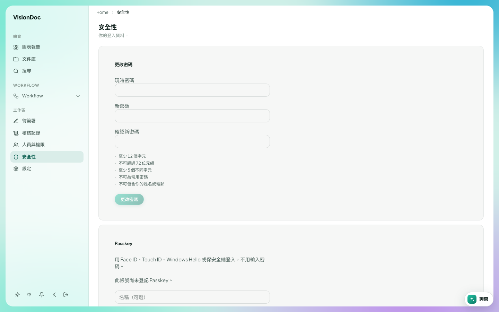

工作區

# 安全性

<figure class="watch">
  <video controls preload="none" playsinline poster="https://visiondoc-tutorials.s3.ap-southeast-1.amazonaws.com/posters/23-security.jpg" src="https://visiondoc-tutorials.s3.ap-southeast-1.amazonaws.com/videos/23-security.mp4"></video>
  <figcaption>看短片。這段短片和字幕都是英文。</figcaption>
</figure>

**安全性** 是你自己的登入，不是公司的名單。標題下面寫 **你的登入資料。**

<figure class="shot">
  
  <figcaption>更改密碼。這個帳號還沒有 Passkey。</figcaption>
</figure>

**更改密碼** 要填 **現時密碼**、**新密碼** 和 **確認新密碼**。新密碼要：

- 至少 12 個字
- 儲存長度不超過 72
- 至少 5 個不同的字
- 不是很多人在用的密碼
- 不要包含你的名字或電郵

按 **更改密碼** 儲存。

**Passkey** 讓你用 Face ID、Touch ID、Windows Hello 或實物鑰匙登入，不用打密碼。這張圖寫 **此帳號尚未登記 Passkey。** **名稱（可選）** 是你給那條鑰匙的名字，例如「辦公室電腦」。

加了 Passkey 之後，登入頁會有 **使用 Passkey 登入**。
