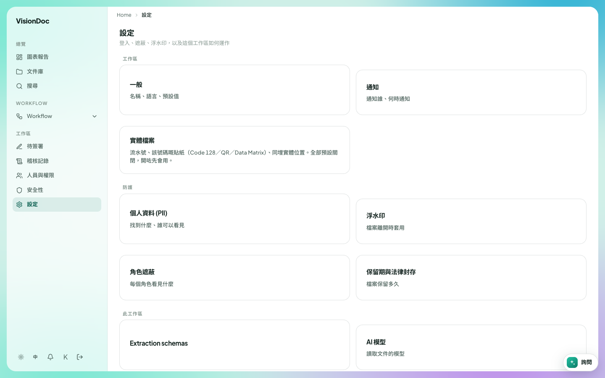

工作區

# 設定

<figure class="watch">
  <video controls preload="none" playsinline poster="https://visiondoc-tutorials.s3.ap-southeast-1.amazonaws.com/posters/24-settings.jpg?v=20261116" src="https://visiondoc-tutorials.s3.ap-southeast-1.amazonaws.com/videos/24-settings.mp4?v=20261116"></video>
  <figcaption>看短片。這段短片和字幕都是英文。</figcaption>
</figure>

**設定** 是公司怎樣運作。標題下面寫 **登入、遮蔽、浮水印，以及這個工作區如何運作**。

<figure class="shot">
  
  <figcaption>公司的設定。實體檔案維持關閉，直到有人打開。</figcaption>
</figure>

| 卡片 | 是甚麼 |
|---|---|
| 一般 | 公司名稱、語言和預設值 |
| 通知 | 通知誰、何時通知 |
| 實體檔案 | 流水號、該號碼的貼紙（Code 128、QR 或 Data Matrix），和架上的位置。全部預設關閉，開了才會用 |
| 個人資料 (PII) | 找到的個人資料，以及誰可以看 |
| 浮水印 | 檔案送出時加上的印 |
| 角色遮蔽 | 每個角色可以看甚麼 |
| 保留期與法律封存 | 檔案留多久。那一頁是 [記錄保留](retention.md) |
| Extraction schemas | 怎樣從文件讀出欄位。這個標題仍是英文 |
| AI 模型 | 讀取文件的模型 |

公司想預設用中文。打開 **一般**，在那裡設定語言。想每份新檔案有一個流水號，打開 **實體檔案** 並開啟。還沒開的時候卡片是關的，圖裡就是這樣。**通知** 是選擇有檔案要人看的時候，通知誰。

## 如何修改設定

1. 打開 **設定**，選擇相關卡片或區塊。
2. 確認正在操作正確公司；設定適用於該公司的工作區。
3. 修改數值後，按該區塊的 **儲存**。離開前確認成功或驗證錯誤訊息。
4. 重新載入確認已儲存，再以適當帳戶及合成測試文件驗證效果。

修改需要 **Edit settings（編輯設定）**，即 `settings:edit` 權限。沒有此權限時，視乎區塊可能只能閱讀，或看不到入口。公司模組或所需服務未開啟，也可能令功能不可用。如何分辨請看 [權限](permissions.md)。

## 應該使用哪個控制

| 你想做甚麼 | 使用甚麼 | 要驗證甚麼 |
|---|---|---|
| 改變某人可以做的操作 | **人員與權限**、自訂角色及個人權限 | 該人的 **Info → Effective permissions** |
| 限制一個資料夾或文件 | Drive 內的 **權限** 編輯器 | 獲准者及被排除者的有效結果 |
| 對非管理員角色隱藏常見敏感類別 | **PII** | 儲存後，分別以 Uploader 和 Compliance 測試 |
| 對指定角色隱藏某欄位或文字模式 | **角色遮蔽** | 正確欄位鍵值／類型、受限角色及實際輸出 |
| 文件離開系統時加上標記 | **浮水印** | 實際生成的輸出；浮水印不會移除敏感值 |
| 改變擷取哪些欄位 | **Extraction schemas（擷取結構）** | 測試文件的欄位及匯出表頭 |
| 為實體文件編號及記錄位置 | **實體檔案** | 只開啟需要的流水號、標籤和位置功能 |
| 設定文件保留期或封存 | **保留期與法律封存** | 文件／資料夾政策及封存狀態；不要把 PII 頁的天數當成刪除排程 |
| 修改自己的密碼或 Passkey | **安全性** | 個人登入設定，與公司設定分開 |

完整遮蔽步驟及現有限制請看 [PII 與角色遮蔽](pii.md)，包括 PII 勾選如何與角色規則合併，以及為甚麼受保護的下載或線上編輯可能被拒絕。

## 確認及還原變更

改政策前先記錄原值。要還原，請改回原值並再次儲存；離開頁面不會撤銷已儲存的變更。文件權限刪除規則後會恢復繼承／預設，結果可能是容許存取。

在 **稽核** 用 **Who**／**What** 查找相關已記錄事件。請用受影響者的帳戶測試：Admin 可以略過文件存取規則及角色遮蔽，不能代表受限者的使用體驗。

圖片及短片提供概覽。實際卡片及控制視乎目前版本、公司模組和你的有效權限而定。
