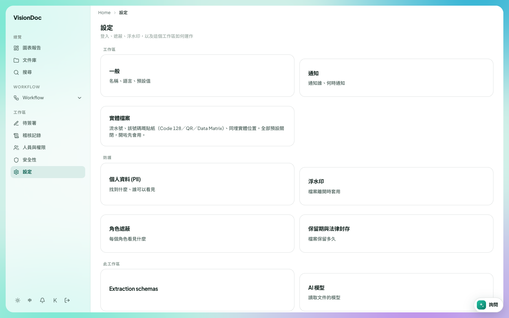

工作區

# 設定

<figure class="watch">
  <video controls preload="none" playsinline poster="https://visiondoc-tutorials.s3.ap-southeast-1.amazonaws.com/posters/24-settings.jpg" src="https://visiondoc-tutorials.s3.ap-southeast-1.amazonaws.com/videos/24-settings.mp4"></video>
  <figcaption>看短片。這段短片和字幕都是英文。</figcaption>
</figure>

**設定** 是公司怎樣運作。標題下面寫 **登入、遮蔽、浮水印，以及這個工作區如何運作**。

<figure class="shot">
  
  <figcaption>公司的設定。實體檔案維持關閉，直到有人打開。</figcaption>
</figure>

| 卡片 | 是甚麼 |
|---|---|
| 一般 | 公司名稱、語言和預設值 |
| 通知 | 通知誰、何時通知 |
| 實體檔案 | 流水號、該號碼的貼紙（Code 128、QR 或 Data Matrix），和架上的位置。全部預設關閉，開了才會用 |
| 個人資料 (PII) | 找到的個人資料，以及誰可以看 |
| 浮水印 | 檔案送出時加上的印 |
| 角色遮蔽 | 每個角色可以看甚麼 |
| 保留期與法律封存 | 檔案留多久。那一頁是 [記錄保留](retention.md) |
| Extraction schemas | 怎樣從文件讀出欄位。這個標題仍是英文 |
| AI 模型 | 讀取文件的模型 |

公司想預設用中文。打開 **一般**，在那裡設定語言。想每份新檔案有一個流水號，打開 **實體檔案** 並開啟。還沒開的時候卡片是關的，圖裡就是這樣。**通知** 是選擇有檔案要人看的時候，通知誰。
