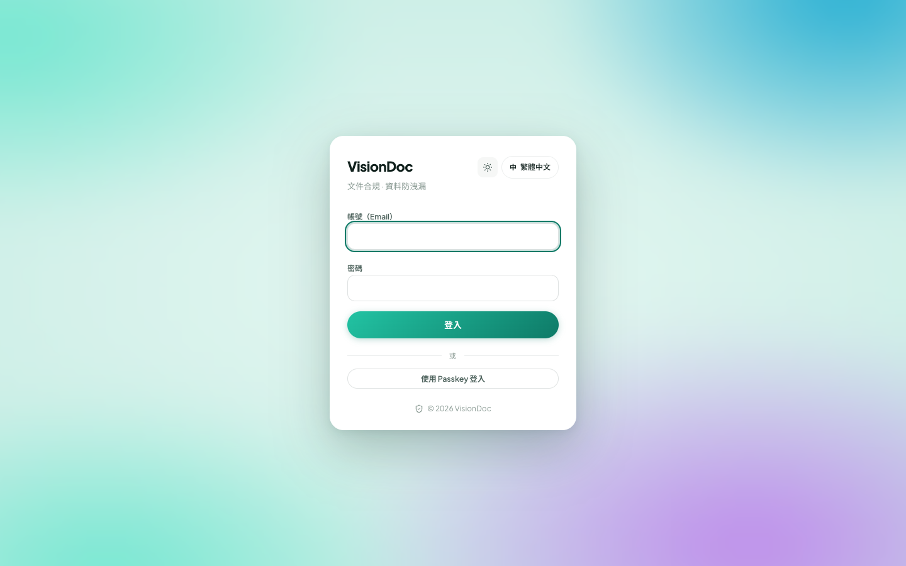

帳戶

# 登入

<figure class="watch">
  <video controls preload="none" playsinline poster="https://visiondoc-tutorials.s3.ap-southeast-1.amazonaws.com/posters/02-sign-in.jpg" src="https://visiondoc-tutorials.s3.ap-southeast-1.amazonaws.com/videos/02-sign-in.mp4"></video>
  <figcaption>看短片。這段短片和字幕都是英文。</figcaption>
</figure>

<figure class="shot">
  
  <figcaption>輸入電郵和密碼，再按登入。</figcaption>
</figure>

1. 打開 [https://app.visiondoc.ai](https://app.visiondoc.ai)。
2. 輸入 **帳號（Email）** 和 **密碼**。
3. 按 **登入**。

用公司給你的帳戶。

帳號或密碼不對，頁面會寫 **帳號或密碼不正確，請再試一次。**

這部瀏覽器已經有你的 Passkey，就可以按 **使用 Passkey 登入**。卡片上的 **中 繁體中文** 把這一頁轉成中文。

登出是左邊選單最下面的門。只是這部瀏覽器登出，文件還在。
