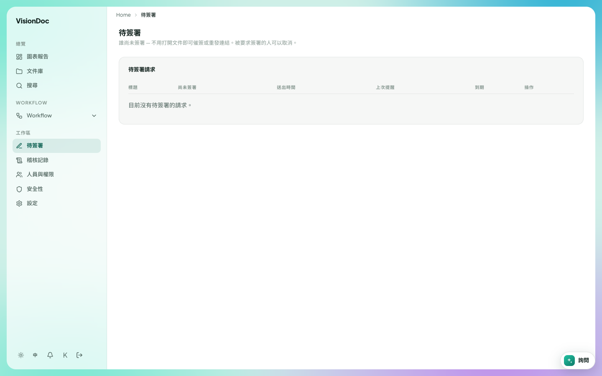

簽署

# 待簽署

<figure class="watch">
  <video controls preload="none" playsinline poster="https://visiondoc-tutorials.s3.ap-southeast-1.amazonaws.com/posters/19-signing.jpg" src="https://visiondoc-tutorials.s3.ap-southeast-1.amazonaws.com/videos/19-signing.mp4"></video>
  <figcaption>看短片。這段短片和字幕都是英文。</figcaption>
</figure>

**待簽署** 是工作區的第一項。它列出還沒簽完的請求。

<figure class="shot">
  
  <figcaption>沒有東西在等簽名。</figcaption>
</figure>

標題下面寫 **誰尚未簽署 — 不用打開文件即可催簽或重發連結。被要求簽署的人可以取消。**

表的名稱是 **待簽署請求**。

| 直欄 | 顯示甚麼 |
|---|---|
| 標題 | 那份文件 |
| 尚未簽署 | 誰還沒簽 |
| 送出 | 請求是幾時送出的 |
| 上次提醒 | 上次催簽是幾時 |
| 到期 | 請求幾時結束 |
| 操作 | 催簽、重發，或取消 |

清單是空的時候寫 **目前沒有待簽署的請求。** 你只看到自己公司的請求。

星期一請了客戶簽報價。到星期三，**尚未簽署** 仍有他的名字。打開 **待簽署**，找到那一行，在 **操作** 發提醒。不用打開檔案。他簽了，那一行就離開這張表。如果 **到期** 的日子已過，要重新發請求，不要再催一次。

交件連結也可以在對方上傳之後要求簽名。那個選項是 **上傳後要求電子簽署**。檔案會留在這一頁，直到名單上的人都簽了。
