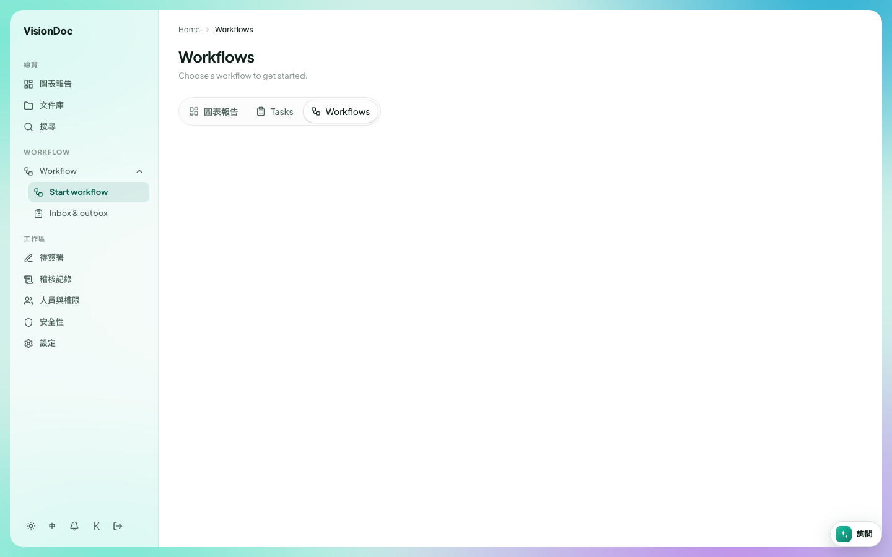

工作

# Start workflow

這頁有一段英文短片，字幕也是英文。<a href="https://visiondoc-tutorials.s3.ap-southeast-1.amazonaws.com/videos/14-start-workflow.mp4">看短片</a>

**Start workflow** 是 Workflow 選單的第一項。它打開 **Workflows**。標題下面寫 **Choose a workflow to get started.**，即是選一個流程來開始。這頁的產品名稱在繁體中文介面仍然是英文。

<figure class="shot">
  
  <figcaption>這家公司還沒有設定流程，所以清單是空的。側欄是繁體中文，頁面標題仍是 Workflows。</figcaption>
</figure>

這裡和圖表報告一樣，有三個分頁：**圖表報告**、**Tasks**、**Workflows**。選中的是 **Workflows**。

例子：營業員在 **Quotation** 有一份報價 PDF，要經理批准。他們打開 **Start workflow**，選公司已經設定的報價流程，附上那份 PDF。那一次流程就會出現在經理的 **Inbox & outbox**。這家公司的清單是空的，所以還沒有可以選的流程。公司管理員在 [Workflow designer](workflow-designer.md) 加一個。
