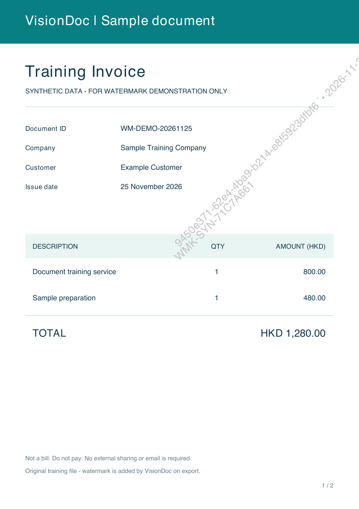
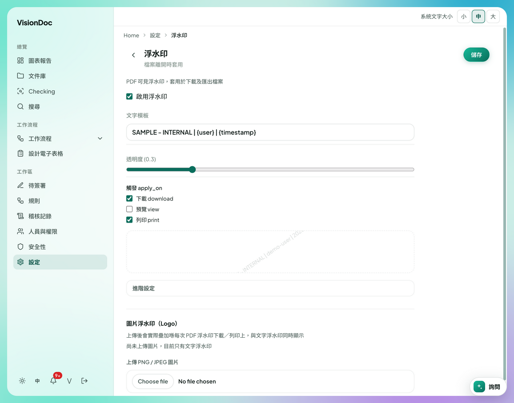
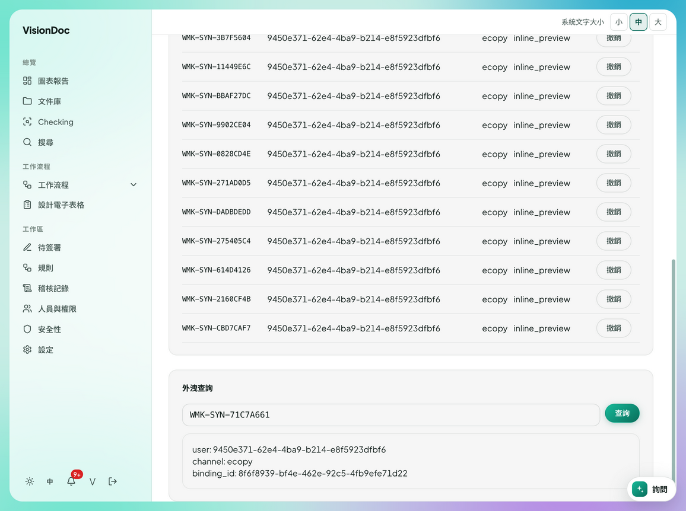

<p class="kicker">工作區 · 設定</p>

# 浮水印教學與樣本

看實際設定畫面、比較加印前後的 PDF，再用識別碼追查輸出來源。這個例子使用兩頁**虛構資料**，於 **2026-11-25 在 VisionDoc Dev** 實測；不是 Production 驗證。

> **先分清楚輸出途徑：**本次一般「下載」只有隱藏追蹤碼；可見浮水印樣本由安全匯出 API 產生。設定頁的自訂字句未出現在安全匯出樣本，長帳號／時間亦有裁切。下面保留實際結果，不能把「設定已儲存」當成「所有下載均已套用」。

<figure class="watch">
  <video controls preload="none" playsinline poster="../assets/watermark/2026-11-25-v1/poster.png" src="../assets/watermark/2026-11-25-v1/tutorial.mp4">
    <track kind="captions" src="../assets/watermark/2026-11-25-v1/captions.zh-Hant.vtt" srclang="zh-Hant" label="繁體中文">
  </video>
  <figcaption>2 分 43 秒。粵語合成配音＋畫面內繁體字幕；真實 Dev 截圖與動畫解說。配音使用本機 Sinji，未作獨立聽音發音驗證。</figcaption>
</figure>

[下載影片](../assets/watermark/2026-11-25-v1/tutorial.mp4) · [下載字幕](../assets/watermark/2026-11-25-v1/captions.zh-Hant.srt) · [中文 PDF 指南](../assets/watermark/2026-11-25-v1/guide.zh-Hant.pdf) · [整份教學包 ZIP](../assets/watermark/2026-11-25-v1/tutorial-pack.zip)

## 下載四份對照樣本

每份都是兩頁 PDF。輸出檔保留伺服器回傳的原始位元組，沒有在本機補印或美化。

| 樣本 | 本次實際結果 |
|---|---|
| [01 原始文件](../assets/watermark/2026-11-25-v1/01-original.pdf) | 未新增浮水印的 Training Invoice；合計 HKD 1,280.00，純示範用途，毋須付款 |
| [02 一般下載](../assets/watermark/2026-11-25-v1/02-hidden-token.pdf) | 外觀與原檔相同，內含隱藏追蹤碼 `WMK-SYN-33B38637` |
| [03 安全列印](../assets/watermark/2026-11-25-v1/03-print-footer.pdf) | 頁腳可見浮水印，Token 為 `WMK-SYN-9039AEBE` |
| [04 安全下載](../assets/watermark/2026-11-25-v1/04-visible-watermark.pdf) | 斜角可見浮水印，Token 為 `WMK-SYN-71C7A661` |

<figure class="shot">
  
  <figcaption>實際安全下載樣本。請下載 PDF 查看兩頁及完整尺寸；圖中保留了文字裁切的現況。</figcaption>
</figure>

## 1. 確認權限與公司

| 操作 | 需要甚麼 |
|---|---|
| 修改浮水印設定 | **Edit settings／編輯設定**：`settings:edit` |
| 上載測試文件 | 讀取、上載能力及目標資料夾的寫入權限 |
| 安全下載／列印 | `download:secure`，以及文件的下載／列印規則允許 |
| 查詢浮水印識別碼 | **Watermark leak lookup／浮水印外洩查詢**：`watermark:lookup` |

公司模組、使用者權限及文件規則是不同控制。先確認登入的是正確公司；詳見[權限中英對照](permissions.md)。

## 2. 設定 → 浮水印

1. 記錄原值，打開 **設定 → 浮水印**。
2. 勾選 **啟用浮水印**。
3. 填寫文字模板，例如 `SAMPLE - INTERNAL | {user} | {timestamp}`。
4. 選擇需要的觸發方式。本次選了 **下載 download**、**列印 print**；沒有開啟匯出通知。
5. 打開 **進階設定**，檢查版型、字級及 Token 行。
6. 按 **儲存**，等成功訊息，再重新載入核對。

<figure class="shot">
  
  <figcaption>設定值已儲存；仍需用下一步的實際輸出確認效果。</figcaption>
</figure>

| 設定 | 用途／例子 |
|---|---|
| 文字模板 | 固定字句與動態欄位。介面列出 `{user}`、`{user_email}`、`{timestamp}`、`{job_id}`、`{doc_type}`、`{watermark_token}`；各輸出路徑是否採用需驗證 |
| 透明度 | 控制可見程度；本次設定為 `0.3` |
| 版型 | **Diagonal／斜角**、**Tiled／平鋪**、**Footer／頁腳** |
| 字級 | 本次設定為 `18 pt` |
| Token 行模板 | `{watermark_token}`，保留識別碼以便追溯 |
| Logo | 另有 PNG／JPEG 圖片上載。本次沒有更改或驗證 Logo |

**本次安全匯出沒有採用自訂的 `SAMPLE - INTERNAL` 字句。**不能只按設定頁的示意預覽，便判斷模板已套用。

## 3. 上載及產生輸出

上載 **01 原始文件**到自己有權限的資料夾，等待處理完成，再打開文件。一般「下載」可取得第二份樣本的隱藏標記效果。

本次文件詳情頁沒有顯示舊版「浮水印」分頁。第三、第四份可見樣本由**已登入的安全匯出 API**產生，並非按普通下載按鈕取得。

### 技術同事：安全匯出 API

系統檢查權限，建立輸出識別碼和紀錄，再產生加印副本。以下呼叫沿用目前登入會話；POST 需要 CSRF 保護。`job_id` 必須是自己獲准存取的文件。

```text
斜角可見輸出：
POST /api/jobs/{job_id}/download
{"user_id":"目前登入者","channel":"ecopy"}

頁腳列印輸出：
POST /api/jobs/{job_id}/print
{"user_id":"目前登入者"}

用回傳的 download_id 取得 PDF：
GET /api/jobs/{job_id}/downloads/{download_id}/file
```

[下載 JavaScript 範例](../assets/watermark/2026-11-25-v1/api-example.js)。程式限用於自己已登入的 **Dev** 會話，不含密碼、不修改政策、不發送電郵。開啟檔案不會執行請求；替換為自己測試文件的 job ID，再由技術同事執行。

## 4. 用 Token 查詢來源

1. 在**同一家公司**，以具 `watermark:lookup` 權限的帳戶打開 **浮水印追溯**，路徑為 `/watermark`。
2. 在 **外洩查詢**貼上該次輸出的 Token，按 **查詢**。
3. 本次成功回傳 **使用者編號、channel: ecopy、binding_id**。

<figure class="shot">
  
  <figcaption>樣本 Token 屬於本次 QA 公司，其他租戶不能跨公司查詢。重新輸出後，請使用自己的新 Token。</figcaption>
</figure>

## 5. 交付前逐頁核對

- 原文是否保留，兩頁是否都有預期標記？
- 實際字句、版型、字級及時間是否符合要求？
- 長帳號／時間有沒有被頁邊裁切？
- Token 是否能在同一公司查到正確來源？

**本次限制：**一般下載沒有可見浮水印；自訂模板未套用到安全匯出；輸出使用帳號 UUID 及原始時間字串，長文字有裁切。未驗證本地時間格式或所有樣式選項已接通。Dev 原設定已還原，Production 未更改。

浮水印用於標記與追溯，不會移除敏感值，也不是防截圖或防移除的保證。敏感資料另見 [PII 與角色遮蔽](pii.md)；設定入口見[設定](settings.md)。
