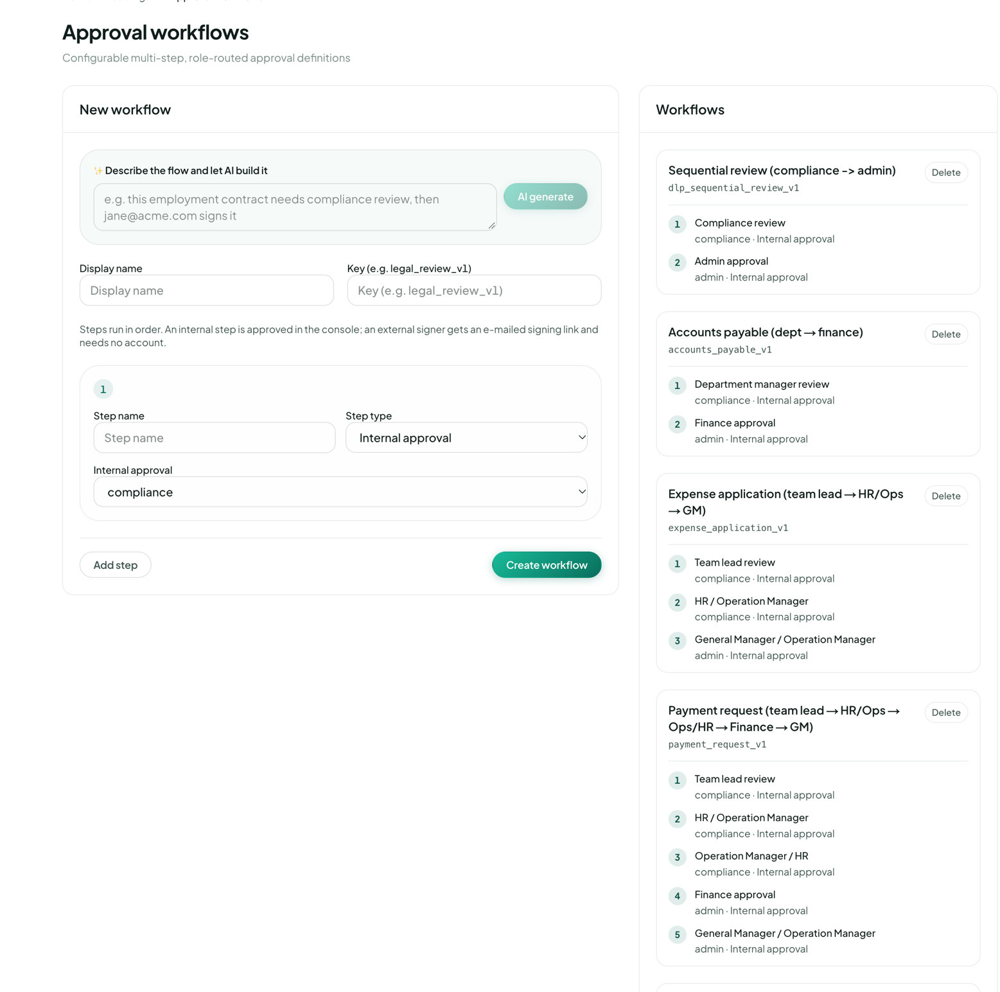

工作

# Workflow designer

這頁有一段英文短片，字幕也是英文。<a href="https://visiondoc-tutorials.s3.ap-southeast-1.amazonaws.com/videos/18-workflow-designer.mp4">看短片</a>

**Workflow designer** 是公司管理員定義流程的地方。側欄上的名稱仍然是英文。頁面標題是 **審批流程**。下面寫 **可設定的多步驟、依角色路由的審批定義**。

<figure class="shot">
  
  <figcaption>建立的地方還沒有填。已經存了四個流程。這張圖是英文畫面。下面會寫出繁體中文介面改了哪些字。</figcaption>
</figure>

這一頁有兩張卡。**新增流程** 用來做一個。**流程** 是已經存好的清單。英文畫面寫 **New workflow** 和 **Workflows**。一份都沒有時寫 **尚無流程**。英文是 **No workflows**。

## 新增流程

第一個框寫 **用文字描述流程，交俾 AI 建立**。英文是 **Describe the flow and let AI build it**。灰色的例子是一份僱傭合約要先做合規審查，然後由 jane@acme.com 簽署。那個電郵只是畫面上的例子，不是這家公司的帳戶。**AI 生成**（英文 **AI generate**）會按你打的那句話填好顯示名稱、鍵和步驟。它還沒有存檔。你仍然要看過步驟，再按 **建立流程**。

同一塊也可以自己填。

| 控制 | 是甚麼 |
|---|---|
| 顯示名稱 | 別人看到的名字，例如 Accounts payable (dept → finance)。英文畫面寫 **Display name** |
| 鍵 | 編號，例如 `accounts_payable_v1`。清單靠這個鍵認出流程。英文畫面寫 **Key** |
| 步驟名稱 | 這一步的名字，例如 Finance approval。英文畫面寫 **Step name** |
| Step type | 誰來做。三個選擇在下面。這個標籤仍然是英文 |
| 下一個選單 | 內部審批時選角色。外部簽署時填電郵 |
| 新增步驟 | 再加一步，編號 2、然後 3。英文畫面寫 **Add step** |
| 建立流程 | 儲存。要有鍵、名稱，和至少一步寫了名稱。英文畫面寫 **Create workflow** |

鍵下面那一行，繁體是 **步驟依序執行。內部審批在後台完成；外部簽署人會收到電郵簽署連結，無需帳號。** 英文是 **Steps run in order. An internal step is approved in the console; an external signer gets an e-mailed signing link and needs no account.** 第 1 步做完，第 2 步才開始。

**Step type** 有三項。

| 類型 | 誰來做 |
|---|---|
| 內部審批 | 帳戶上有那個角色的人，在主控台裡批准。選單裡的角色是 **compliance**、**admin**、**uploader**。這三個字仍然是英文 |
| 外部簽署 | 一個電郵。對方收到簽署連結，不用 VisionDoc 帳戶 |
| JavaScript 工作 | 這一步跑一小段程式，交回 JSON。畫面裡已存的流程都沒有用這一種 |

角色不是步驟的名字。**Department manager review** 下面仍然可以寫 **compliance**。名字是標籤。角色才是誰可以批。這三個角色在 [人員與權限](people.md) 裡設在每一個人身上。

存好的流程不能在清單裡改。要改就另做一個，用另一個鍵。**Delete** 刪掉這個流程，之後 [Start workflow](start-workflow.md) 就不能再選它。這個按鈕的字仍然是英文。

## 流程

每一個已存的流程有名稱、鍵、按次序的步驟，和 **Delete**。每一步下面，第一個字是角色，後面是步驟類型。這張圖裡每一步都是 **Internal approval**。繁體中文介面這句是 **內部審批**。

### Sequential review (compliance → admin)

鍵 `dlp_sequential_review_v1`。

| 步 | 名稱 | 誰批 |
|---|---|---|
| 1 | Compliance review | compliance |
| 2 | Admin approval | admin |

角色是 compliance 的人先審。然後角色是 admin 的人批准。

### Accounts payable (dept → finance)

鍵 `accounts_payable_v1`。這是供應商發票走的流程。

| 步 | 名稱 | 誰批 |
|---|---|---|
| 1 | Department manager review | compliance |
| 2 | Finance approval | admin |

第一步的名字是部門經理。可以批的人是任何角色為 compliance 的人。財務批准是任何角色為 admin 的人。

### Expense application (team lead → HR/Ops → GM)

鍵 `expense_application_v1`。這是費用申請走的流程。

| 步 | 名稱 | 誰批 |
|---|---|---|
| 1 | Team lead review | compliance |
| 2 | HR / Operation Manager | compliance |
| 3 | General Manager / Operation Manager | admin |

頭兩步都是 compliance 這個角色。靠步驟名字把它們分開。最後一步是 admin。

### Payment request (team lead → HR/Ops → Ops/HR → Finance → GM)

鍵 `payment_request_v1`。

| 步 | 名稱 | 誰批 |
|---|---|---|
| 1 | Team lead review | compliance |
| 2 | HR / Operation Manager | compliance |
| 3 | Operation Manager / HR | compliance |
| 4 | Finance approval | admin |
| 5 | General Manager / Operation Manager | admin |

五步，照這個次序。頭三步是 compliance。後兩步是 admin。

例子：一份報價先給經理，再給客戶簽。顯示名稱 **報價批准**。鍵 `quotation_approval_v1`。第 1 步 **經理批准**，類型 **內部審批**，角色 **admin**。按 **新增步驟**。第 2 步 **客戶簽署**，類型 **外部簽署**，填客戶的電郵。**建立流程**。它會出現在 **流程** 裡。之後在 [Start workflow](start-workflow.md) 可以選這個流程，附上 **Quotation** 裡的 PDF。
