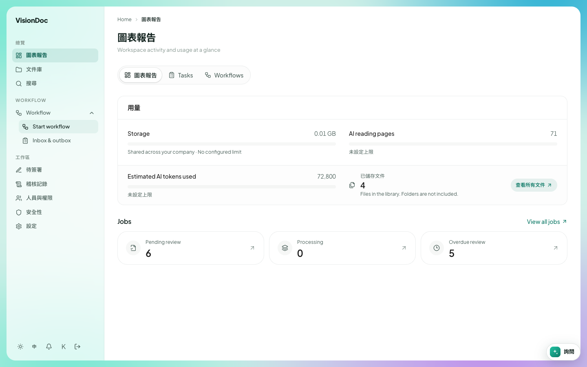
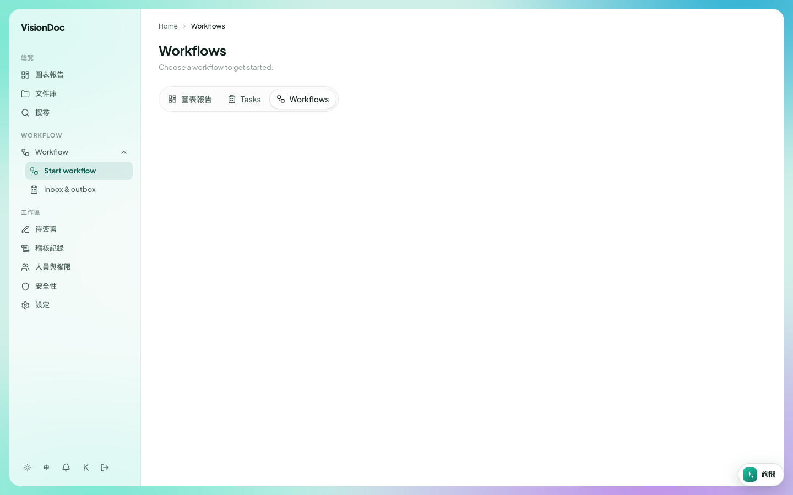
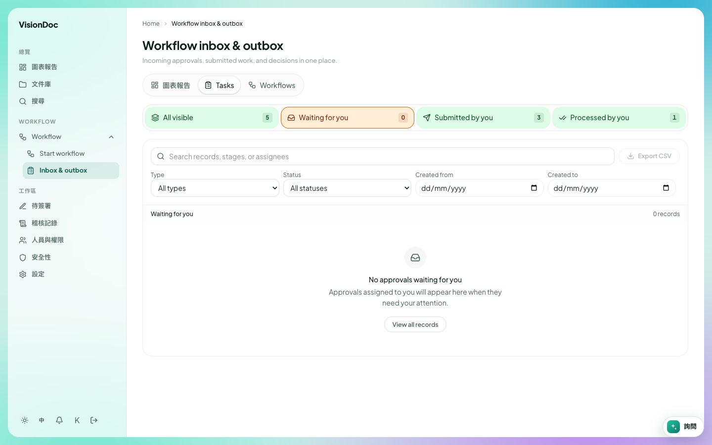
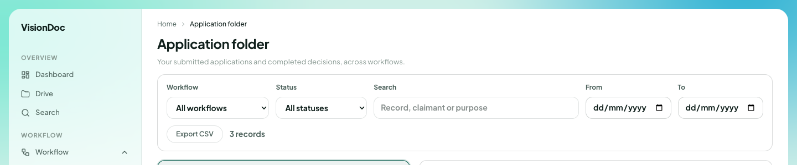

工作

# Workflow

**Workflow** 是 WORKFLOW 標題下面、右邊有箭嘴的那一行。點那一行，箭嘴轉向上，選單才打開。那一行本身不是一頁。

<figure class="shot">
  
  <figcaption>這家公司的選單：Start workflow 和 Inbox &amp; outbox。</figcaption>
</figure>

畫面裡的選單有兩項。這兩項的產品名稱在繁體中文介面仍然是英文。

| 項目 | 用來做甚麼 |
|---|---|
| Start workflow | 選一個流程，然後開始 |
| Inbox & outbox | 看等你處理的、你送出的，和你已經決定的 |

**Application folder** 是同一組的另一頁，公司有用才會出現。這家公司的選單畫面沒有它。這頁的標題也是英文。

## Start workflow

**Start workflow** 打開 **Workflows**。標題下面寫 **Choose a workflow to get started.**，即是選一個流程來開始。

<figure class="shot">
  
  <figcaption>這家公司還沒有設定流程，所以清單是空的。側欄是繁體中文，頁面標題仍是 Workflows。</figcaption>
</figure>

這裡和圖表報告一樣，有三個分頁：**圖表報告**、**Tasks**、**Workflows**。選中的是 **Workflows**。

例子：營業員在 **Quotation** 有一份報價 PDF，要經理批准。他們打開 **Start workflow**，選公司已經設定的報價流程，附上那份 PDF。那一次流程就會出現在經理的 **Inbox & outbox**。這家公司的清單是空的，所以還沒有可以選的流程。

## Inbox & outbox

**Inbox & outbox** 是已經在走的流程。標題是 **Workflow inbox & outbox**。下面寫 **Incoming approvals, submitted work, and decisions in one place.**，即是待批、已送出和已決定的，放在同一個地方。

<figure class="shot">
  
  <figcaption>選了 Waiting for you。這個帳戶沒有要批的東西。頁面文字是英文，側欄是繁體中文。</figcaption>
</figure>

上面有四個數目。畫面是：

| 數目 | 畫面 |
|---|---|
| All visible | 5 |
| Waiting for you | 0 |
| Submitted by you | 3 |
| Processed by you | 1 |

選中的是 **Waiting for you**。清單寫 **No approvals waiting for you.** 下面一行是 **Approvals assigned to you will appear here when they need your attention.** **View all records** 會離開這個空的篩選。

圖表報告的 **Tasks** 打開的是同一張清單，而且 **Tasks** 那個分頁是選中的。

搜尋框寫 **Search records, stages, or assignees**。**Type** 是 **All types**。**Status** 是 **All statuses**。**Created from** 和 **Created to** 填日期。**Export CSV** 下載你正在看的清單。

例子：經理打開 **Inbox & outbox**，留在 **Waiting for you**，批准那份報價。批完之後，**Waiting for you** 回到 0，**Processed by you** 加 1。營業員打開同一頁，選 **Submitted by you**，看到自己已經送出的 3 份。如果只想看還沒完的，把 **Status** 離開 **All statuses**。

## Application folder

**Application folder** 是每一份申請和它的決定。標題下面寫 **Your submitted applications and completed decisions, across workflows.**

<figure class="shot">
  
  <figcaption>上面是篩選。記錄沒有放進這張圖。這頁畫面是英文。</figcaption>
</figure>

| 控制 | 做甚麼 |
|---|---|
| Workflow | **All workflows**，或者只選一個流程 |
| Status | **All statuses**，或者只選一個狀態 |
| Search | **Record, claimant or purpose** |
| From / To | 一段日期 |
| Export CSV | 下載符合的列 |

畫面寫 **3 records**。那些列沒有放進說明書。

例子：上星期交了一份報價，你只想看還沒完成的。把 **Status** 離開 **All statuses**，在用途裡打一個字，**From** 和 **To** 設成那個星期。**Export CSV** 存下那些列。畫面的 **3 records** 是這家公司的數目，不是上限。
