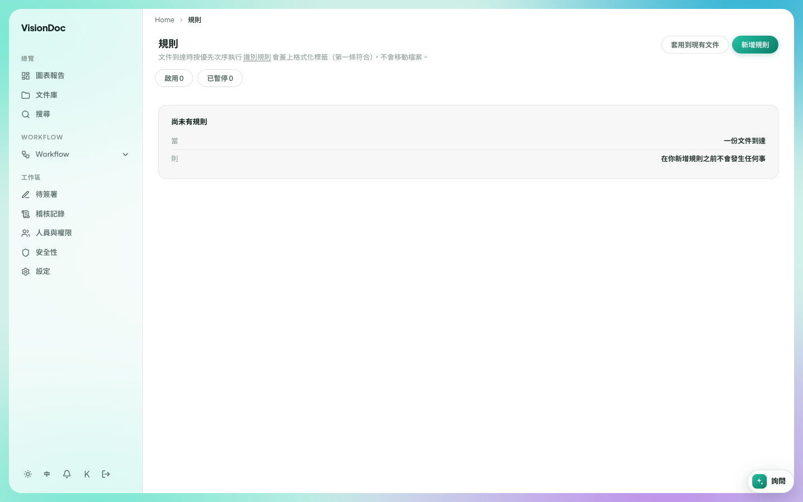
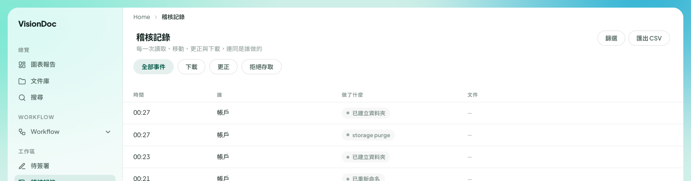
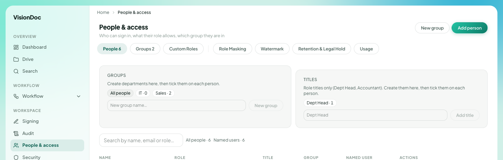
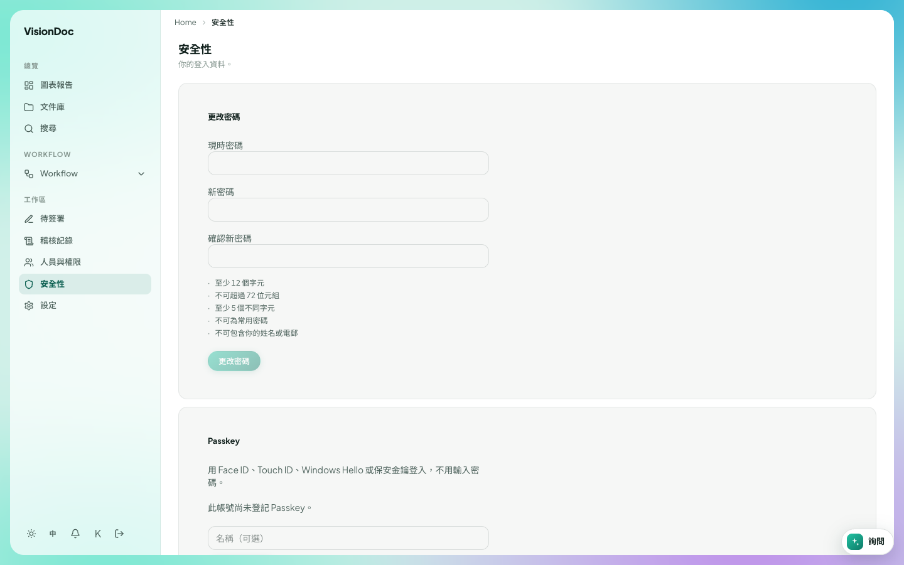
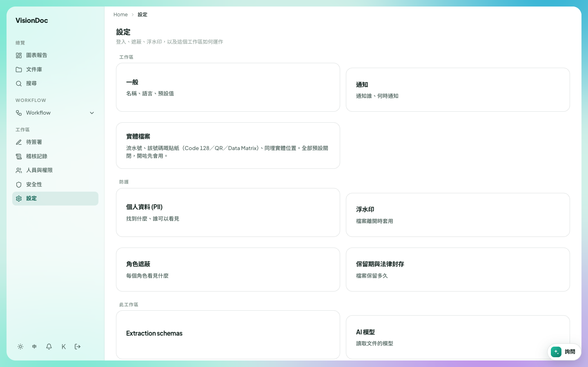

側欄

# 工作區

**工作區** 是側欄下面那一組。畫面裡是 **待簽署**、**稽核記錄**、**人員與權限**、**安全性**、**設定**。公司管理員看得到設定。其他人只看到自己角色允許的項目。

**待簽署** 有自己的一頁。其餘在下面。**規則** 是歸檔用的另一頁。這家公司的側欄畫面沒有那一行。

## 規則

**規則** 在每份文件到達時按優先次序執行。標題下面寫：識別規則會蓋上格式化標籤（第一條符合），不會移動檔案。

<figure class="shot">
  
  <figcaption>尚未有規則。啟用 0，已暫停 0。</figcaption>
</figure>

空的卡片寫 **尚未有規則**。下面兩行是 **當 一份文件到達** 和 **則 在你新增規則之前不會發生任何事**。**啟用** 是 0。**已暫停** 是 0。

**新增規則** 加一條。**套用到現有文件** 把規則套到已經在文件庫裡的文件。

例子：發票一到就要蓋上 `INV-2026` 這種標籤，不用人手搬文件。用 **新增規則** 加這一條。還沒加之前，新文件到達不會發生任何事，空卡片寫的就是這個。規則開啟之後，**啟用** 變成 1。**套用到現有文件** 會給已經在文件庫的發票蓋上標籤。想停用又不想刪掉，就暫停它，**已暫停** 加 1。

## 稽核記錄

**稽核記錄** 的副題是 **每一次讀取、移動、更正與下載，連同是誰做的**。

<figure class="shot">
  
  <figcaption>四筆事件。這幾列的文件欄是空的。後面的列沒有放進畫面。</figcaption>
</figure>

標題下面有四個篩選：**全部事件**、**下載**、**更正**、**拒絕存取**。**篩選** 再收窄。**匯出 CSV** 下載這張清單。

欄是 **時間**、**誰**、**做了什麼**、**文件**。畫面裡每一列的 **誰** 都是 **帳戶**。**做了什麼** 是 **已建立資料夾**、**storage purge**、再一次 **已建立資料夾**，和 **已重新命名**。時間是 00:27、00:27、00:23、00:21。這幾列的 **文件** 是一條橫線。

例子：有人說夜裡多了一個資料夾。打開 **稽核記錄**，留在 **全部事件**，看 **已建立資料夾** 那幾列。如果只想看離開工作區的文件，選 **下載**。**匯出 CSV** 留一份這個畫面。這張圖在任何檔名出現之前就裁掉了。

## 人員與權限

**人員與權限** 是誰可以登入、角色允許甚麼、人在哪一組。下面這張圖的頁面文字是英文。側欄的名稱是 **人員與權限**。

<figure class="shot">
  
  <figcaption>群組和職稱。人名沒有放進這張圖。頁面文字是英文。</figcaption>
</figure>

右上角是 **New group** 和 **Add person**。

| 分頁 | 畫面 |
|---|---|
| People | 6 |
| Groups | 2 |
| Custom Roles | 自己加的角色 |
| Role Masking | 每個角色看到甚麼 |
| Watermark | 檔案離開時的標記 |
| Retention & Legal Hold | 檔案留多久 |
| Usage | 這家公司的儲存和讀取 |

**Groups** 寫 **Create departments here, then tick them on each person.** 選項是 **All people**、**IT · 0**、**Sales · 2**。輸入框是 **New group name…**。

**Titles** 寫 **Role titles only (Dept Head, Accountant). Create them here, then tick them on each person.** 畫面有 **Dept Head · 1**。

表格欄是 **Name**、**Role**、**Title**、**Group**、**Named user**、**Actions**。搜尋框是 **Search by name, email or role…**。旁邊寫 **All people · 6** 和 **Named users · 6**。

例子：兩個人在營業部。**Sales · 2** 就是那一組。在 **New group name…** 打一個新部門，按 **New group**，再在每個人身上勾選。**Dept Head · 1** 表示已經有一個人是這個職稱。在 **Titles** 的框再加一個，按 **Add title**，勾在應該有這個職稱的人身上。名字沒有放進這張圖。

## 安全性

**安全性** 的副題是 **你的登入資料。** 這是你自己的帳戶，不是公司名單。

<figure class="shot">
  
  <figcaption>更改密碼。這個帳戶還沒有 Passkey。</figcaption>
</figure>

**更改密碼** 要填 **現時密碼**、**新密碼**、**確認新密碼**。新密碼要：

- 至少 12 個字元
- 不可超過 72 位元組
- 至少 5 個不同字元
- 不可為常用密碼
- 不可包含你的姓名或電郵

**更改密碼** 儲存它。

**Passkey** 可以用 Face ID、Touch ID、Windows Hello 或安全鑰登入，不用輸入密碼。畫面寫 **此帳號尚未登記 Passkey。** **名稱（可選）** 是你給那條鑰匙的名字。

例子：把短密碼換成 12 個字元、而且不含自己姓名的密碼。輸入兩次，按 **更改密碼**。不想再打密碼，就在同一頁加一條 Passkey，名稱例如「辦公室電腦」。登入頁之後會有 **使用 Passkey 登入**。

## 設定

**設定** 的副題是 **登入、遮蔽、浮水印，以及這個工作區如何運作**。

<figure class="shot">
  
  <figcaption>公司工作區。實體檔案在有人開啟之前全部關閉。</figcaption>
</figure>

| 卡片 | 是甚麼 |
|---|---|
| 一般 | 名稱、語言、預設值 |
| 通知 | 通知誰、何時通知 |
| 實體檔案 | 流水號、該號碼嘅貼紙（Code 128／QR／Data Matrix）、同埋實體位置。全部預設關閉，開咗先會用 |
| 個人資料 (PII) | 找到什麼、誰可以看見 |
| 浮水印 | 檔案離開時套用 |
| 角色遮蔽 | 每個角色看見什麼 |
| 保留期與法律封存 | 檔案保留多久 |
| Extraction schemas | 怎樣從文件讀出欄位。這個標題仍是英文 |
| AI 模型 | 讀取文件的模型 |

例子：公司想預設用繁體中文。打開 **一般**，在那裡設語言。想每份新文件有一個流水號，打開 **實體檔案** 再開啟。沒開之前那些功能是關的，畫面寫的就是這個。**通知** 用來選誰會收到「有文件要審」的通知，以及甚麼時候送。
